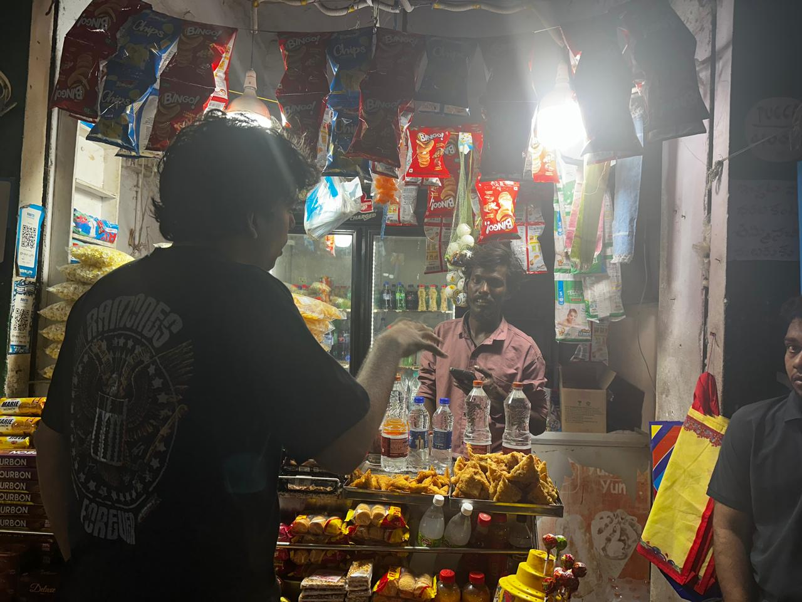
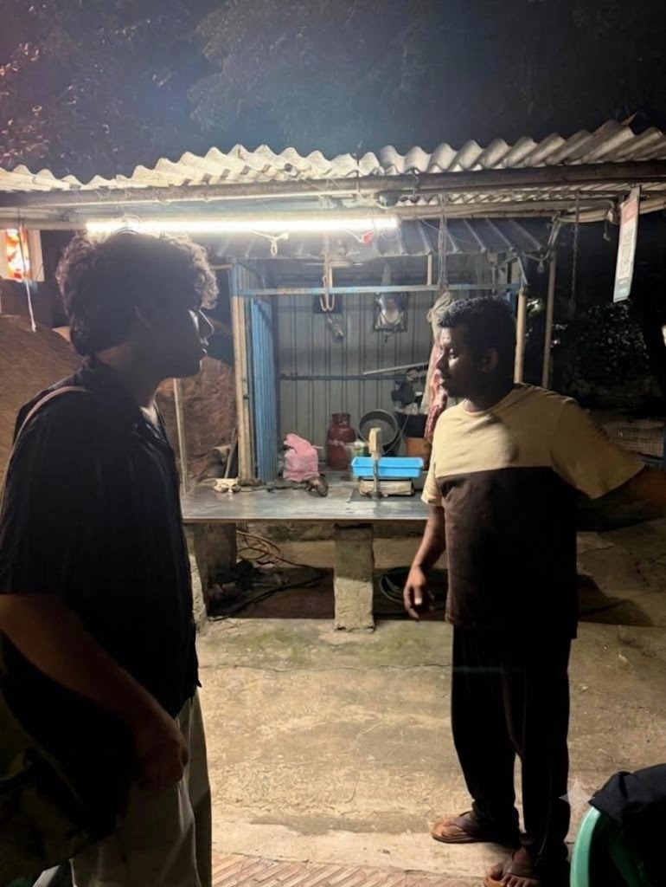

# MAYA

## V4 customer product

The current product is a mobile customer app, an independently paired judge view,
a recipient view and a server-owned dummy ledger. Use `run_demo.py`; the older
Streamlit and `src/api.py` entrypoints below remain research examples.

```powershell
.\.venv\Scripts\python.exe -m pip install -r requirements-dev.txt
.\.venv\Scripts\python.exe scripts/bootstrap_v4.py
.\.venv\Scripts\python.exe scripts/train_wallet_bundle.py
.\.venv\Scripts\python.exe run_demo.py
```

Open `http://127.0.0.1:8000/app/`. Pair `/demo/` and `/recipient/` in separate
browsers using the codes from the customer payment screen. Dummy payment success
comes from committed ledger state. No real money, bank credentials or government
report submission are involved.

See [Docker/HTTPS deployment](docs/DEPLOY_V4.md), [release status and limits](docs/V4_RELEASE_STATUS.md)
and [frozen evidence](docs/evidence). A public deployment requires a hosting
account/server and hostname. No bank-ready or national-throughput claim is made.

For the audit response, see the [rubric delivery matrix](docs/RUBRIC_DELIVERY.md),
[shadow-pilot blueprint](docs/MAYA_PILOT_BLUEPRINT.md), [six-minute judge runbook](docs/JUDGE_RUNBOOK.md)
and [asset/contribution ledger](docs/CONTRIBUTION_LEDGER.md). The [evidence rebuild guide](docs/EVIDENCE_REPRODUCTION.md)
lists commands, data boundaries and limitations for reproducing the frozen reports.
The latest generated-event kit is 20/24; it names spaced-probe and slow-drip misses.
The age fairness slice is flagged for review, and all generated metrics remain
simulator evidence rather than real-UPI performance claims.

The public companion sends derived intent only; raw message parsing stays in the
browser. It abstains from behavioral scoring without bank history. The sandbox,
public PaySim benchmark and partner-model contracts are separate sources.

## Background & Field Research

MAYA's merchant-safety priorities were informed by visits to around 10 street
vendors, fruit sellers and kirana stores around the NIT Warangal campus. These
conversations and observations grounded the project in the conditions small
merchants face while accepting UPI payments.

Recurring concerns included dependence on soundboxes for payment confirmation,
connectivity interruptions, fake payment claims and phishing SMS reaching
vendors' phones. Together, these findings point to a practical need: make payment
status clear and help merchants recognize suspicious claims and messages without
adding friction to everyday transactions.



*Field visit at a neighborhood kirana store near NIT Warangal.*



*Field visit at a streetside vendor stall near NIT Warangal.*

## Run the generated-event spot-check

After building `models/wallet/` with `scripts/train_wallet_bundle.py`, run
`python scripts/run_kit.py`. Each invocation creates fresh synthetic event
histories; use `--seed N` to reproduce a run. Its 24 cases are authored policy
checks, not a real-world accuracy estimate. The current frozen run is
[`docs/evidence/kit.json`](docs/evidence/kit.json). See [the rubric matrix](docs/RUBRIC_DELIVERY.md)
for known misses and the additional evidence still required.

---

Synthetic UPI scam-journey detector and Streamlit demonstration. The core uses
past-only payment/recipient features, XGBoost, conformal prediction and a
two-group intervention policy. No real payments or external fraud reports occur.

## Local setup (Python 3.12)

```powershell
python -m venv .venv
.\.venv\Scripts\python.exe -m pip install -r requirements-dev.txt   # core + pytest
.\.venv\Scripts\python.exe -m pytest -v
.\.venv\Scripts\python.exe src/policy.py --self-test
.\.venv\Scripts\python.exe -m streamlit run ui/app.py
```

On macOS/Linux use `.venv/bin/python` for the interpreter. `requirements-dev.txt`
is `requirements-core.txt` plus pytest. The core requirements exclude the
optional PyTorch/GNN experiment; `requirements.txt` retains the full
experimental dependencies.

`python -m pytest` runs every test, including the unittest-style ones and an
end-to-end smoke pipeline (generator → features with the exact brute-force check
→ train → conformal → `policy.py --eval`) in a temp dir. `tests/test_ui.py`
drives `ui/app.py` with Streamlit's AppTest and is skipped unless the trained
`models/` exist.

## Rebuild a small synthetic baseline

Run from the repository root. These are smoke artifacts, not the submitted B4
experiment or evidence of real-world accuracy.

```text
python src/journey_generator.py --smoke     # -> data/smoke/
python src/features.py --smoke
python src/train_xgb.py --smoke             # -> models/*_smoke.json
python src/conformal.py --smoke
```

Without `--smoke` the same four commands build the full dataset and the
`models/xgb_model.json` + `models/conformal.json` that the UI loads (~6 min).
Generated CSV/Parquet and model JSON files are ignored by Git. Validate
generator output (`campaign_split_violations=0`, `ref_integrity=True`) and
feature output (all sample maximum differences are zero).

The UI scenarios use features copied from real test-split transactions and, by
default, the model-implied conformal set drives `decide()`; a sidebar toggle
pins the scripted sets instead.

## Risk-scoring API (how a bank or UPI app would use Maya)

A bank or UPI app calls Maya before releasing each payment. `src/api.py` serves
that as a local FastAPI simulator (needs the trained `models/`):

```text
python -m uvicorn api:app --app-dir src     # http://127.0.0.1:8000/docs
python scripts/demo_bank_client.py          # second terminal: a demo "bank"
```

`POST /v1/score` takes the 27-feature contract plus the amount and optional soft
signals and returns release / nudge / hold with reasons; `/v1/payments...` wraps
the stateful payment-review service. See `docs/API.md`.

The same server hosts two web frontends (no build step):
**`/demo/`** — the judges' view for the big screen — shows a QR code; phones that
scan it open **`/app/`**, the everyday-user payment app (English / हिंदी), and
every payment they make appears on the demo screen live, with why Maya decided.
Run `python src/attack_sim.py --json-out models/attack_results.json` once so the
demo's Robustness tab has numbers.

**Put it online** (free, permanent `https://` address, phones anywhere):
`python scripts/build_space.py --github YOUR_GITHUB/maya-site` publishes the
site bundle to a private deploy repository that Render (free tier) builds and
serves. See [docs/DEPLOY_SPACE.md](docs/DEPLOY_SPACE.md).

## Evaluation commands

```text
python src/policy.py --eval          # release / nudge / hold rates on the test split
python src/attack_sim.py --strict    # evasion attacks: split payments, extra mule hop
python src/federated_sim.py          # two-bank FedAvg vs locals vs pooled data
python src/gnn_challenger.py         # GraphSAGE mule challenger (needs requirements.txt)
```

The model is adversarially trained against split payments and extra mule hops
(`src/evasion.py`); `attack_sim` holds out split_10 and the combined attack.
These are known, white-box attacks on synthetic data — see `AGENTS.md` for the
numbers and caveats.

## Team workflow

Branch from the current shared base, implement one reviewable stage, run its
checks, and open a pull request. Do not push directly to `main`. Merge only after
team review. Keep generated datasets, model files and credentials out of commits.
See `docs/WORK_LOG.md` for repository decisions and validation.

## Finale direction

Preserve the baseline detector; add a simulated payment review, narrow
claim-to-operation comparison with abstention, review invalidation when payment
details change, and immutable evidence replay. See the planning log for scope.
All holds require independent signal groups, including at least one history or
recipient group; a scam-only prediction does not override that requirement.
