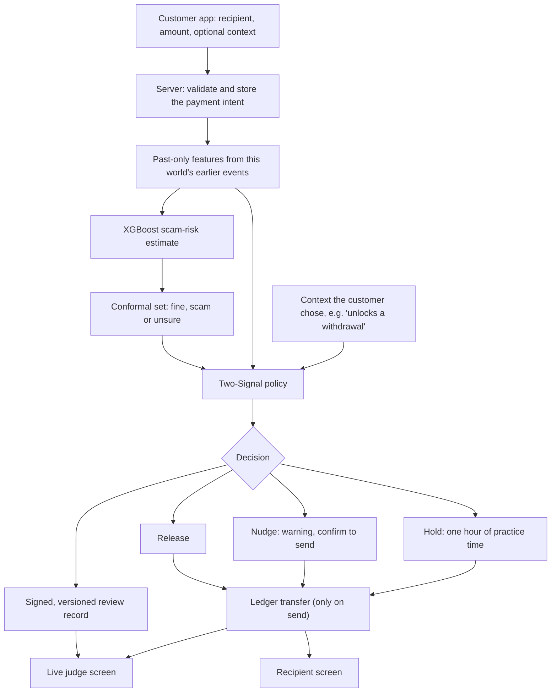
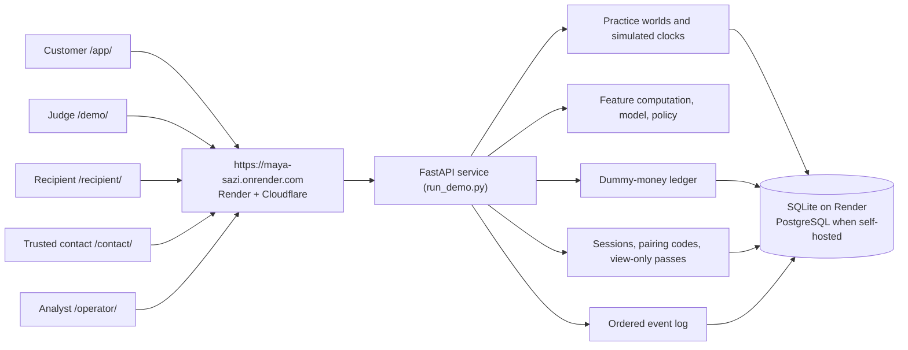

# MAYA
### Explainable AI for safer digital payments

**MAYA helps people recognize suspicious UPI payment journeys before they trust a transaction.** It brings together transaction patterns, recipient-network signals and contextual warning signs, then explains whether a payment should proceed, prompt a warning or receive further review.

**Try it live: <https://maya-sazi.onrender.com>.** Open it on one phone as the person paying, and scan the QR it shows with a second phone to watch as the judge.

This repository contains:

- **The MAYA product** that runs on the live site: a customer payment app, separately paired judge, recipient, trusted-contact and analyst screens, and a server-owned dummy-money ledger.
- **The research pipeline**: synthetic journey generator, past-only features, XGBoost with adversarial training, conformal uncertainty, the Two-Signal policy, robustness, fairness and benchmark tools.
- **The earlier research website** (the `src/api.py` scoring API with its own phone and presenter pages), also published as [ldcode20/maya-site](https://github.com/ldcode20/maya-site).

> **Demo and research software, not a banking service.** Every payment is simulated with practice money. MAYA does not access bank accounts, move real money, block transactions in other UPI apps or submit reports to government systems. Model evaluations use synthetic data and are **not** evidence of real-world fraud-detection accuracy.

## Explore MAYA

| Screen | Address | Who uses it |
| --- | --- | --- |
| **Customer app** | [`/app/`](https://maya-sazi.onrender.com/app/) | The person paying. Pick a practice situation, make a payment, see MAYA's decision and act on it. |
| **Judge screen** | [`/demo/`](https://maya-sazi.onrender.com/demo/) | A judge or audience on their own phone or a projector. Follows every step live and can propose a payment, but can never approve one. |
| **Recipient screen** | `/recipient/` | Shows the money that actually arrived. Only ledger-recorded transfers appear, so a screenshot cannot fake one. |
| **Trusted contact** | `/contact/` | A family member the customer opted in. Sees held payments and can only give advice. |
| **Analyst console** | `/operator/` | A bank analyst (separate secret key). Approves or rejects held payments over ₹1 lakh. |
| **Evidence** | `/demo/benchmarks.html` | Recorded benchmark runs, with their limits. Open it from a paired judge screen. |
| **Health** | `/readyz` | Shows `"status":"ready"` once the model and storage are loaded. |

The root URL opens the customer app. The interface is in **English and Hindi**; the Hindi text is a draft and should be reviewed by a native speaker before a broader launch.

### Try the two-phone demo

1. **Phone 1 (paying):** open <https://maya-sazi.onrender.com/app/> and pick a practice situation.
2. Tap **Make a payment**, then **Connect judge device**. A QR code and a 12-character code appear.
3. **Phone 2 (judge):** scan the QR with the camera. It opens the judge screen, already connected. Typing the code at `/demo/` also works.
4. On phone 1, pay someone. The judge screen shows each step the server takes, the decision, its reasons and the transfer ID.
5. **To see a hold:** choose *After a "stock tips" group*, pay **R K Traders** (for example ₹30,000) and pick *Payment unlocks a withdrawal*. The payment is held. **Skip ahead 1 hour of practice time**, then **Send dummy payment anyway**.
6. **Over ₹1 lakh:** after skipping ahead, an analyst must approve. Open `/operator/`, sign in with the operator key, approve, then tap **Check again** on phone 1 and send.

Paired screens stay connected when the customer switches situation. Pairing codes work once and expire in 5 minutes; viewer access lasts 30 minutes and can be revoked from Settings.

### Practice situations

Each situation is a generated *practice world*: a made-up payment history with the same cast (Amma, the landlord Ananya, the Corner Store, R K Traders, City Collections and dozens of other people).

| Situation | What is in its history |
| --- | --- |
| **Everyday payments** | Family, rent and the corner shop. Nothing unusual, so ordinary payments go through. |
| **After a "stock tips" group** | R K Traders paid you a small "profit"; dozens of strangers also pay it, and it is linked to a reported account. |
| **After tiny test payments** | The same, plus ₹1, ₹2 and ₹5 test payments to R K Traders minutes ago. |
| **A refund that asks you to pay** | A stranger's small credit and a message saying "approve to receive your refund". |

Situations change only the generated history. Every decision still comes from the live model and policy.

### Check a message

**Check a message** reads a pasted message or UPI link **inside the browser** and sends only three labels to the server (direction, purpose, operation), never the text. It recognizes a small set of English and Hindi patterns, such as withdrawal fees or taxes on "profits" and "enter your PIN to receive" refunds. Anything else stays "unknown", and MAYA says it has limited information rather than guessing.

## Why MAYA?

Digital-payment scams can develop across several interactions rather than a single obviously suspicious transfer. A victim may first receive a convincing message or call, make a small test transfer, trust a supposed investment or refund, and then be pushed toward a larger payment.

MAYA is designed around three principles:

- **Understand the journey:** inspect available payment history, recent transfers and recipient-network relationships rather than judging only the payment amount.
- **Require corroboration before a hold:** do not freeze a payment solely because of an alarming message, a phone signal or a model prediction.
- **Make decisions understandable:** show the user what raised concern and distinguish a warning from a stronger intervention.

## Background & Field Research

MAYA's merchant-safety priorities were informed by visits to around 10 street vendors, fruit sellers and kirana stores around the NIT Warangal campus. These conversations and observations grounded the project in the conditions small merchants face while accepting UPI payments.

Recurring concerns included dependence on soundboxes for payment confirmation, connectivity interruptions, fake payment claims and phishing SMS reaching vendors' phones. Together, these findings point to a practical need: make payment status clear and help merchants recognize suspicious claims and messages without adding friction to everyday transactions.


*Field visit at a neighborhood kirana store near NIT Warangal.*


*Field visit at a streetside vendor stall near NIT Warangal.*

These are qualitative field observations from a small group of merchants, rather than a representative survey. They help explain why MAYA emphasizes clear status, readable warnings and a low-friction payment experience. The recipient screen reflects this directly: it shows money as received only once the ledger records it.

## How the detection works

When a customer checks a payment, the server computes the payment's history signals from that practice world's past events, scores them with an XGBoost model, measures how sure that score is, and applies an explicit safety policy. The browser only displays the server's result.



### 1. Transaction and recipient features

The model accepts **27 features**: nine feature families, each represented as a combined value, a sender-side value (`_snd`) and a receiver-side value (`_rcv`).

| Feature family | Meaning in everyday language |
| --- | --- |
| `n_t` | Unusual breadth of recent counterparties or new-payment relationships. |
| `e_t` | Payment size relative to previous first-contact transfers. |
| `g_t` | Recent incoming activity involving new counterparties. |
| `z_t` | How different this amount is from past payment sizes. |
| `pi_t` | Small probing or test transfers preceding a larger request. |
| `d_R` | Short graph links involving previously reported suspicious accounts. |
| `v_t` | Frequency of recent transfers between the same pair of accounts. |
| `zc_t` | Cumulative payment volume, helping expose a larger amount split into several transfers. |
| `ptr_t` | Rapid onward movement of incoming funds, where supporting history exists. |

These features are built from **past-only evidence**: information that would not have been available at the time of a payment must not influence its score. Missing information is represented explicitly rather than invented. Full definitions and time-window rules are in the [feature contract](docs/FEATURE_CONTRACT.md).

### 2. Model and uncertainty

The XGBoost model estimates scam risk. **Mondrian conformal prediction** then forms a calibrated output set: `{fine}`, `{scam}` or `{fine, scam}` (unsure). This makes the difference between a confident result and a situation that needs caution visible.

The live product uses a small **wallet model** trained on generated practice worlds, separate from the larger research model trained on the batch dataset. Both are calibrated on held-out **synthetic** data, which cannot be read as a guarantee of performance on real bank transactions.

### 3. The Two-Signal Rule

A model score alone cannot cause a hold. MAYA separates supporting evidence into independent groups:

- **Payment history:** unusual transfers, amounts, repeated payments or probes.
- **Receiving account:** links to reported accounts or simulated mule-account information.
- **Context:** what the payment is for, e.g. "unlocks a withdrawal" or "approve to receive a refund" (in the research website, also simulated call, screen-sharing or chat pressure).

| Outcome | Meaning |
| --- | --- |
| **Release** | The conformal result is `{fine}`. The payment can proceed. |
| **Nudge** | Not clearly fine, but there is not enough independent evidence to hold it. The customer sees a warning and must confirm to send. |
| **Hold** | Not clearly fine **and** independent groups agree: payment history + recipient evidence, or at least one of those + context. |

**Context alone never justifies a hold**, and removing the context does not clear a hold on the same payment. A hold lasts **one hour of the practice world's clock**. The customer can skip ahead an hour (clearly labelled as practice time; a real hold would last a real hour). The payment is then checked again, needs explicit confirmation, and over **₹1,00,000** also needs an analyst to approve that fresh check. These are **demo policy rules**, not holds at a bank.

### 4. Explanations and transparency

Every decision comes with plain-language reasons. The judge screen also shows the server's measured steps, the evidence groups present, the prediction set and score, the model/calibration/feature/policy versions, all 27 feature values with their SHAP contributions, and the recorded payment connections. Review records are signed, and a review can be exported.

### 5. Adversarial research

The research code explores evasion patterns such as splitting payments, extra recipient hops and changes to probing. It adds generated-event robustness kits, held-out scam-type checks, fairness slices and a separately reported PaySim experiment. Known misses (for example spaced-out probing and slow-drip payments) are disclosed rather than tuned away. **None of these checks substitutes for independent evaluation on real UPI fraud data.**

The research code also includes a **GraphSAGE graph-neural-network challenger** and a **two-bank federated-learning simulation**. These are experiments, not part of the live payment path.

## System architecture

The live product is **one Python (FastAPI) service**, started by `run_demo.py`. It serves the web pages and the API, makes every decision and keeps all state in one database. The pages are plain HTML, CSS and JavaScript; there is no frontend build step.



| Layer | How it works |
| --- | --- |
| **Pages** | Customer app, judge/recipient/contact view and analyst console, served by the same service. |
| **Identity** | Each browser gets a signed, HttpOnly session cookie automatically; there are no customer logins. |
| **Pairing** | "Connect device" creates a one-time, 5-minute code, also shown as a QR. The other device trades it for its own view-only pass (a separate cookie, 30 minutes, revocable), and the code is removed from its address bar. |
| **Live updates** | The judge screen keeps a Server-Sent Events connection open and the server pushes each step as it happens. Recipient and contact screens re-check every 2 seconds. |
| **Practice worlds** | Each situation is a generated world with its own payment history and its own clock. Switching situation moves the judge and recipient passes along; trusted-contact consent is per world. |
| **Decisions** | Feature computation, model, conformal set and policy run on the server. Every review is stored as a signed, versioned record. |
| **Ledger** | Only "send" writes a transfer: practice money out of the customer, into the recipient. The receipt, the recipient's balance and the judge screen all show that same transfer ID. |
| **Analyst** | A separate secret key (`MAYA_OPERATOR_KEY`) unlocks the queue of held payments over ₹1 lakh. Decisions are bound to the exact payment revision and check, and stale ones fail. |
| **Privacy** | Message checks are read in the browser; only derived labels reach the server. Raw message text is not an accepted API field. Practice worlds and checks expire on a retention timer. |
| **Safety at the edge** | Production mode sets Secure cookies and HSTS, refuses cross-origin requests and limits request rates per visitor. |

### The research website (`src/api.py`)

The earlier research website is a separate FastAPI app with its own `/app/` phone page and `/demo/` presenter page, built on the batch research model. It scores a 27-feature row through `POST /v1/score`, pairs phones through in-memory six-character rooms, and shows simulated outcomes **without** a ledger. It is published separately as [ldcode20/maya-site](https://github.com/ldcode20/maya-site). Both apps use `/app/` and `/demo/`, but they are different interfaces; the live site runs the product above.

## Run MAYA locally

Requires **Python 3.12**.

```bash
git clone https://github.com/ldcode20/MAYA-SAZI.git
cd MAYA-SAZI
python -m venv .venv
```

Activate the environment (`source .venv/bin/activate` on macOS/Linux, `.\.venv\Scripts\Activate.ps1` in Windows PowerShell), then:

```bash
python -m pip install -r requirements-dev.txt
python scripts/bootstrap_v4.py          # builds the synthetic demo bundle (once, about a minute)
python scripts/train_wallet_bundle.py
python run_demo.py                      # http://127.0.0.1:8000
```

Open <http://127.0.0.1:8000/app/>. To pair a second device, use the code in a second browser window at `/demo/`. On a phone on the same Wi-Fi, start with `--host 0.0.0.0` and open the laptop's address instead of `127.0.0.1`. To try the analyst console, set `MAYA_OPERATOR_KEY` to any random text of 32+ characters before starting, then sign in at `/operator/` with it.

### Run the research website

Build the full research dataset and model first (about 6 minutes), then start the research API:

```bash
python src/journey_generator.py && python src/features.py
python src/train_xgb.py && python src/conformal.py
python -m uvicorn api:app --app-dir src   # http://127.0.0.1:8000/demo/
```

## Deploy

### Render (how the live site runs)

[`render.yaml`](./render.yaml) deploys this repository to Render's free tier as one Docker service. The [`Dockerfile`](./Dockerfile) trains the synthetic demo bundle while building, so no model weights are stored in Git.

1. Sign in at [render.com](https://render.com) with GitHub and allow access to this repository.
2. **New → Blueprint**, pick the repository, then **Apply**.
3. Wait for the first build (5–10 minutes), then check `https://<your-service>.onrender.com/readyz`.
4. Copy `MAYA_OPERATOR_KEY` from the service's **Environment** page to use `/operator/`.

Every merge to `main` redeploys automatically.

| Setting | Value | Purpose |
| --- | --- | --- |
| `MAYA_ENV` | `production` | Secure cookies, HSTS, no API docs page. |
| `MAYA_SESSION_SECRET` | generated by Render | Signs sessions. |
| `MAYA_OPERATOR_KEY` | generated by Render | Unlocks the analyst console. |
| `MAYA_TRUST_FORWARDED_FOR` | `1` | Rate limits use the client address Render's proxy appends, never client-supplied ones. |
| `MAYA_REQUESTS_PER_MINUTE` | `1200` | Per-visitor request budget. |
| `MAYA_PUBLIC_ORIGIN` | optional | Defaults to Render's own address; set it for a custom domain. |
| `MAYA_DATABASE_URL` | optional | A PostgreSQL URL for storage that survives redeploys. |

**Free-tier limits:** the service sleeps after about 15 idle minutes and the next visit takes about a minute to wake it, so open `/readyz` a few minutes before a demo. SQLite storage is wiped on every restart or redeploy. It runs as one instance. Details: [Deploy MAYA on Render](docs/DEPLOY_RENDER.md).

### Self-managed server

For your own Linux server, `compose.yaml` runs the same image with **PostgreSQL** and **Caddy HTTPS**. It needs a domain, DNS, persistent secrets and a deployment rehearsal. See the [V4 deployment guide](docs/DEPLOY_V4.md).

## API at a glance

| Endpoint | Purpose |
| --- | --- |
| `GET /readyz` · `GET /v1/health` | Readiness: model loaded, storage reachable. |
| `GET /v1/model` | Model, calibration and version information. |
| `POST /v1/sandbox/worlds` | Start a practice world (`preset`: `everyday`, `investment`, `probes`, `refund`). |
| `POST …/worlds/{id}/intents` · `PUT …/intents/{pid}` | Create or edit a payment. |
| `POST …/intents/{pid}/review` | Run features, model and policy; returns the signed decision. |
| `POST …/intents/{pid}/execute` · `…/cancel` | Send (writes the ledger transfer) or cancel. |
| `POST …/worlds/{id}/clock` | Move that world's practice clock forward (owner only). |
| `POST …/worlds/{id}/pair` · `POST /v1/observe/pair` | Create a one-time code; trade it for a view-only pass. |
| `POST …/worlds/{id}/observers/carry` | Move paired judge and recipient screens to a new world. |
| `GET /v1/observe` · `GET /v1/observe/events` | What a paired screen may see; the judge's live event stream. |
| `POST /v1/observe/scenario` | Judge proposes a payment for the customer to review. |
| `POST /v1/checks` | Message check (three derived labels only). |
| `POST …/worlds/{id}/cases` | Download an evidence draft (never submitted anywhere). |
| `GET /v1/operator/queue` · `POST /v1/operator/decision` | Analyst queue and approve/reject (needs `X-Operator-Key`). |

Every state-changing call needs an `Idempotency-Key` header where it creates something, and must come from the site's own origin. The research website's API (`/v1/score`, `/v1/rooms`, `/v1/payments`) is documented in [docs/API.md](docs/API.md).

## Testing

```bash
python -m pytest                    # product, policy, pipeline and API tests
python src/policy.py --self-test     # the Two-Signal truth table
node scripts/verify_browser.cjs      # three real browsers against a running server on :8003
```

The browser check pairs a judge and a recipient (one by typing the code, one by QR link) and confirms that **the same transfer ID** appears on all three devices. It also runs a full hold journey, checks that the judge follows a switch of situation, confirms that raw message text never leaves the browser, and checks revocation and phone-width layout. Recorded evaluation results and their limits are in [docs/RUBRIC_DELIVERY.md](docs/RUBRIC_DELIVERY.md) and [docs/evidence](docs/evidence).

## Project layout

```text
MAYA-SAZI/
├── run_demo.py              # Starts the live product (binds $PORT on Render)
├── Dockerfile               # Image; trains the synthetic demo bundle at build time
├── render.yaml              # Render Blueprint for the live site
├── compose.yaml             # Self-managed: app + PostgreSQL + Caddy
├── frontend/
│   ├── product/             # Customer app (/app/)
│   ├── observer/            # Judge, recipient and contact screens; evidence page
│   ├── operator/            # Analyst console
│   ├── user/ judge/         # Research website pages (src/api.py)
│   └── shared/              # Fonts, QR encoder, shared assets
├── src/
│   ├── product_api.py       # Live product API, sessions, pairing, operator
│   ├── simulator_service.py # Practice worlds, reviews, holds, ledger
│   ├── simulation.py        # Practice-world generator (situations)
│   ├── online_features.py   # Past-only features for a single payment
│   ├── storage.py           # SQLite / PostgreSQL adapter
│   ├── policy.py            # Two-Signal policy
│   ├── api.py, rooms.py     # Research website API and demo rooms
│   └── ...                  # Generator, features, training, conformal, research experiments
├── scripts/                 # Bootstrap, training, evaluation reports, browser check
├── tests/
└── docs/                    # Deployment, feature contract, evidence, rubric and runbook
```

## Responsible use and limitations

MAYA is a **working prototype** intended for demonstration and research, not a certified anti-fraud solution.

- **No real transactions:** there is no connection to UPI rails or bank accounts. "Sent", "released" and "held" move only practice-money ledger balances.
- **Practice time:** holds run on each practice world's simulated clock so that a demo can show a full hour. A real deployment would use real time.
- **Simulated external signals:** MuleHunter.AI, the DoT Financial Fraud Risk Indicator and the 1930/NCRP report are mocks. The "evidence draft" is a download, never a submitted report.
- **Synthetic training and evaluation:** strong results on generated data do not predict accuracy on real UPI fraud. The live wallet model is deliberately small (it reaches near-perfect separation on its generated worlds), so most holds are decided by the Two-Signal rules. PaySim, used in a separate benchmark, is also synthetic.
- **Narrow message check:** the in-browser rules cover a few common English and Hindi phrasings; reworded messages can slip past it, and it then says it has limited information.
- **Limited context:** the product does not monitor calls, messages, bank transactions or other UPI apps.
- **No enforcement elsewhere:** only a bank or payment provider that controls authorization can hold a real payment.
- **Prototype infrastructure:** free hosting sleeps and resets its storage; the analyst key is a shared demo credential, not individual authentication.
- **Known research gaps:** disclosed misses (spaced-out probing, slow-drip payments) and a fairness slice flagged for review are reported in the [evaluation and limits report](docs/RUBRIC_DELIVERY.md).

The goal is to make payment-risk reasoning and user protection **clear, conservative and auditable**, while keeping real-world claims within the evidence available.

## More information

- **Live site:** <https://maya-sazi.onrender.com>
- **Deploy on Render:** [docs/DEPLOY_RENDER.md](docs/DEPLOY_RENDER.md) · **Self-managed:** [docs/DEPLOY_V4.md](docs/DEPLOY_V4.md)
- **Six-minute judge runbook:** [docs/JUDGE_RUNBOOK.md](docs/JUDGE_RUNBOOK.md)
- **Evaluation and limits:** [docs/RUBRIC_DELIVERY.md](docs/RUBRIC_DELIVERY.md) · [frozen evidence](docs/evidence) · [rebuild guide](docs/EVIDENCE_REPRODUCTION.md)
- **Feature definitions:** [docs/FEATURE_CONTRACT.md](docs/FEATURE_CONTRACT.md)
- **Pilot blueprint and contributions:** [docs/MAYA_PILOT_BLUEPRINT.md](docs/MAYA_PILOT_BLUEPRINT.md) · [docs/CONTRIBUTION_LEDGER.md](docs/CONTRIBUTION_LEDGER.md)
- **Research website:** [ldcode20/maya-site](https://github.com/ldcode20/maya-site) · [its API](docs/API.md)
- **Change history:** [docs/WORK_LOG.md](docs/WORK_LOG.md)

---

**MAYA: check the payment, understand the warning, make a safer choice.**
