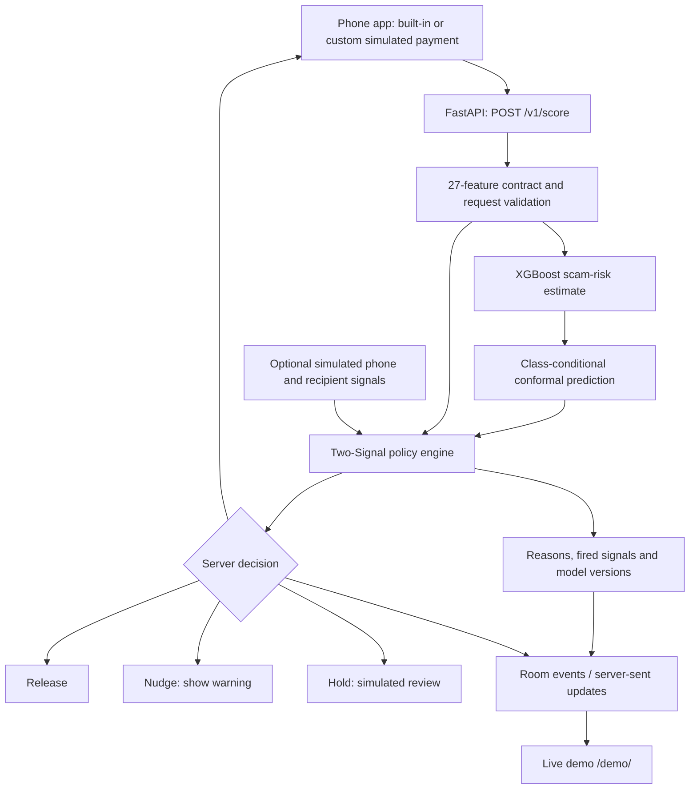
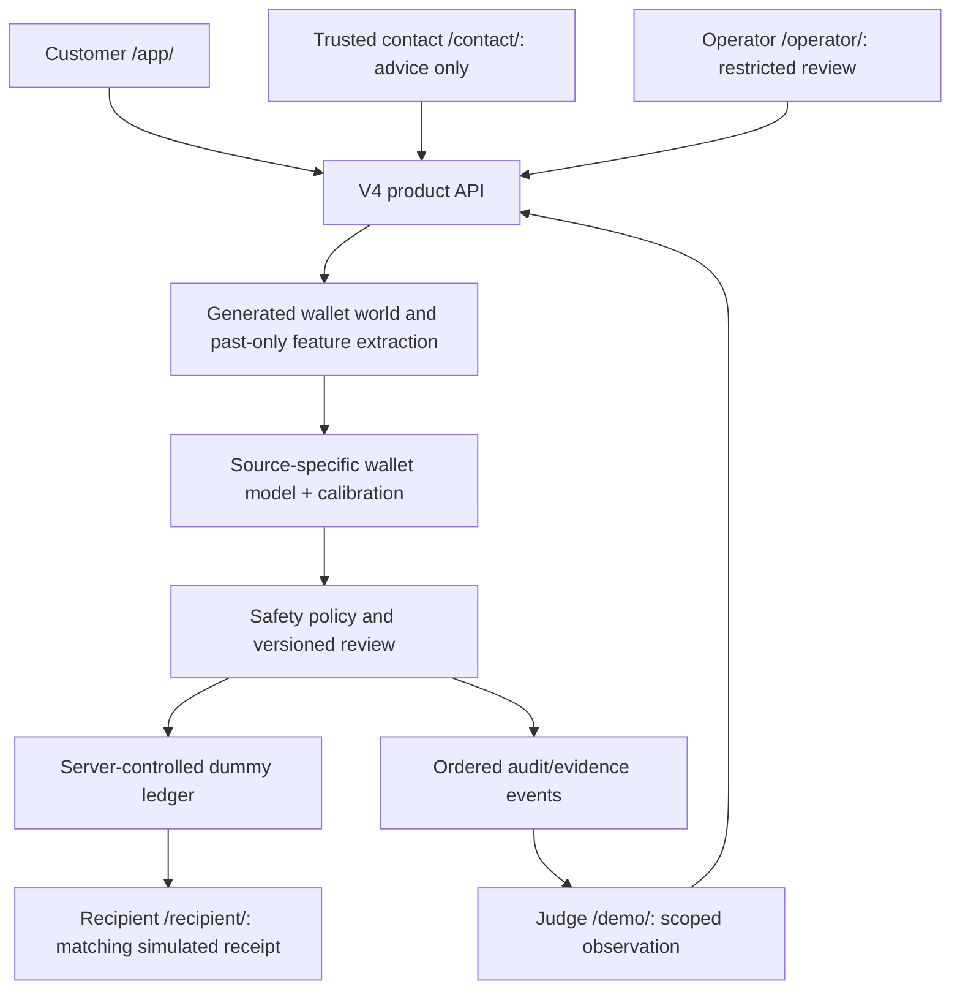

# MAYA
### Explainable AI for safer digital payments

**MAYA helps people recognize suspicious UPI payment journeys before they trust a transaction.** It brings together transaction patterns, recipient-network signals and contextual warning signs, then explains whether a payment should proceed, prompt a warning or receive further review.

The [MAYA website](https://github.com/ldcode20/maya-site) is the **interactive, deployable demonstration**. The companion [MAYA-SAZI repository](https://github.com/ldcode20/MAYA-SAZI) contains the expanded customer product, server-controlled dummy-payment sandbox, research pipeline and evaluation tools.

> **Demo and research software, not a banking service.** All payments on the public MAYA website are simulated. It does not access real bank accounts, transfer money, block transactions in external UPI apps, or submit reports to government systems. Model evaluations use synthetic data and are **not** evidence of real-world fraud detection accuracy.

## Explore MAYA

Once the website is running or deployed, the main experiences are:

| Experience | Address | What you can do |
| --- | --- | --- |
| **Live demonstration** | `/demo/` | Present MAYA on a large screen, pair a phone with a QR code, see decisions and explanations as payments are simulated. |
| **Mobile payment experience** | `/app/` | Choose a scenario or describe a payment, review MAYA's advice, and experience the simulated payment flow. |
| **Interactive API reference** | `/docs` | Explore the model-scoring, demo-room and payment-review API. |
| **Service health** | `/v1/health` | Check whether the model and review service are loaded. |

The root URL (`/`) opens the live demo. The website supports **English and Hindi** interfaces; the Hindi text is a draft and should be reviewed by a native speaker before a broader public launch.

### Try the live, two-screen demo

1. Open **`/demo/`** on a laptop, projector or desktop.
2. Scan its QR code with your phone. Alternatively, open **`/app/`** and enter the pairing code under Settings.
3. Select one of the built-in payment journeys, or use **Your own payment** to enter a recipient, amount and contextual details.
4. Tap **Pay** in the phone experience. MAYA evaluates the *simulated* payment.
5. Watch the main screen update with the action, relevant signal groups, explanatory reasons, and available scenario or robustness details.

The demo page can also run built-in scenarios without a second device. Multiple phones can connect to one room, with live updates delivered from the server.

### Scenarios included with the website

| Scenario | What it illustrates |
| --- | --- |
| **Familiar recipient** | A legitimate payment that MAYA can release even when an amount is larger than usual. |
| **Investment scam** | A high-risk request linked to a fabricated investment-return story and suspicious recipient evidence. |
| **Fake police / coercion** | A pressure-based payment request, with contextual phone signals such as active screen sharing. |
| **Unclear payment** | An uncertain case where a warning can be more appropriate than an automatic hold. |

The **Your own payment** form converts plain-language answers into a representative synthetic feature row. It is a way to explore the model, **not** a check against your real transaction history or a verified recipient database.

## Why MAYA?

Digital-payment scams can develop across several interactions rather than a single obviously suspicious transfer. A victim may first receive a convincing message or call, make a small test transfer, trust a supposed investment or refund, and then be pushed toward a larger payment.

MAYA is designed around three principles:

- **Understand the journey:** inspect available payment history, recent transfers and recipient-network relationships rather than judging only the payment amount.
- **Require corroboration before a hold:** do not freeze a payment solely because of an alarming message, a phone signal or a model prediction.
- **Make decisions understandable:** show the user what raised concern and distinguish a warning from a stronger intervention.

## Background & Field Research

MAYA's merchant-safety priorities were informed by visits to around 10 street vendors, fruit sellers and kirana stores around the NIT Warangal campus. These conversations and observations grounded the project in the conditions small merchants face while accepting UPI payments.

Recurring concerns included dependence on soundboxes for payment confirmation, connectivity interruptions, fake payment claims and phishing SMS reaching vendors' phones. Together, these findings point to a practical need: make payment status clear and help merchants recognize suspicious claims and messages without adding friction to everyday transactions.


*Field visit at a neighborhood kirana store near NIT Warangal.*


*Field visit at a streetside vendor stall near NIT Warangal.*

These are qualitative field observations from a small group of merchants, rather than a representative survey. They help explain why MAYA emphasizes clear status, readable warnings and a low-friction payment experience.

## How the detection works

MAYA's website uses an XGBoost classifier trained on **generated transaction journeys**. The model supplies a risk estimate; an uncertainty-calibration layer and an explicit safety policy determine the final intervention. The browser displays the server's decision rather than computing a verdict of its own.



### 1. Transaction and recipient features

The model accepts **27 features**: nine feature families, each represented as a combined value, a sender-side value (`_snd`) and a receiver-side value (`_rcv`).

| Feature family | Meaning in everyday language |
| --- | --- |
| `n_t` | Unusual breadth of recent counterparties or new-payment relationships. |
| `e_t` | Payment size relative to previous first-contact transfers. |
| `g_t` | Recent incoming activity involving new counterparties. |
| `z_t` | How different this amount is from past payment sizes. |
| `pi_t` | Small probing or test transfers preceding a larger request. |
| `d_R` | Short graph links involving previously reported suspicious accounts. |
| `v_t` | Frequency of recent transfers between the same pair of accounts. |
| `zc_t` | Cumulative payment volume, helping expose a larger amount split into several transfers. |
| `ptr_t` | Rapid onward movement of incoming funds, where supporting history exists. |

These features are built from **past-only evidence** in the research pipeline: information that would not have been available at the time of a payment must not influence its score. Missing information is represented explicitly rather than invented. The full definitions and time-window rules are documented in [MAYA-SAZI's feature contract](https://github.com/ldcode20/MAYA-SAZI/blob/main/docs/FEATURE_CONTRACT.md).

### 2. Model and uncertainty

The XGBoost model estimates scam risk. **Mondrian conformal prediction** then forms a calibrated output set: `{fine}`, `{scam}` or `{fine, scam}` (uncertain). This makes the distinction between a confident classification and a situation that needs caution visible.

The calibration is derived from held-out **synthetic** data. It cannot be interpreted as a guarantee of performance on real bank transactions.

### 3. The Two-Signal Rule

A model score alone cannot cause a hold. MAYA separates supporting evidence into three groups:

- **Payment history:** unusual transfers, amounts, repeated payments or probes.
- **Receiving account:** suspicious recipient-network or simulated mule-account information.
- **Phone and context:** simulated call activity, screen sharing or chat-payment pressure.

| Outcome | Meaning |
| --- | --- |
| **Release** | The conformal result is `{fine}`. The demo payment can proceed. |
| **Nudge** | The result is not clearly fine, but there is insufficient independent evidence to hold it. The user sees a warning. |
| **Hold** | The result is not clearly fine **and** independent groups agree: payment history + recipient evidence, or at least one of those hard-evidence groups + phone/context evidence. |

**Phone or chat signals alone never justify a hold.** For holds in the website's policy, the displayed simulated timer is 60 minutes; amounts above ₹1,00,000 are marked for analyst review. These are **demo policy rules**, not actual holds at a bank.

### 4. Explanations and transparency

The API can return human-readable risk reasons, active signal groups, model/calibration/policy versions and, on request, detailed feature contributions computed with SHAP. The demo includes an evidence panel, model card and robustness view so the decision can be inspected instead of presented as an unexplained score.

### 5. Adversarial research

The research code explores fraud-evasion patterns such as splitting payments, additional recipient hops and changes to probing behavior. The website includes a snapshot of those synthetic robustness tests. MAYA-SAZI adds generated-event tests, held-out scam-type checks, source-specific wallet modeling, fairness slices and a separately reported PaySim experiment. **None of these checks substitutes for independent evaluation on real UPI fraud data.**

The companion codebase also includes a **synthetic journey generator**, adversarial training/evaluation tools, a **GraphSAGE graph-neural-network challenger**, and a **two-bank federated-learning simulation**. These are research experiments, not components of the website's synchronous payment-scoring path.

## System architecture

### Deployed website: `maya-site`

The web demonstration is a **single Python/FastAPI service**, with static pages served by the same application. No Node.js build pipeline, external database or separate frontend server is needed for the usual two-screen demo.

| Layer | Implementation | Responsibility |
| --- | --- | --- |
| Presentation | HTML, CSS and JavaScript modules | Responsive phone interface, demo screen, settings, localization and visual explanations. |
| Live pairing | Room codes and Server-Sent Events | Pair mobile browsers with the demo display and stream server-produced results. |
| API | FastAPI and Pydantic | Validate requests, expose scoring/review endpoints and serve the web interfaces. |
| Risk model | XGBoost | Evaluate the 27 numerical features. |
| Calibration and policy | Conformal prediction + Two-Signal Rule | Separate risk estimation from the final action. |
| Explanation | SHAP and reason templates | Report understandable, evidence-aligned reasons. |
| Demonstration integrations | Deterministic mock connectors | Represent recipient/mule flags, DoT fraud indicators and reporting flows without live integrations. |
| Research review storage | SQLite, in memory by default | Record optional API-based reviews and payment revisions; **not** a money ledger. |
| Hosting | Python 3.12 Docker image / Render Blueprint | Package and serve the website. |

The website uses **in-memory demo rooms**, so pairings disappear after a restart, sleep or redeploy. One application worker is used to keep the room state consistent. The public phone flow shows simulated outcomes; it does **not** commit a payment to a balance ledger.

### Extended sandbox: `MAYA-SAZI`

The companion repository builds on the research into a more complete **dummy-payment product**, with its own entry point (`run_demo.py`) and deployment package:



Its customer app includes payment review, editable payment details, activity and receipt screens. A separate judge can observe or propose a new *scenario input* but cannot authorize a transfer. A paired recipient sees only its own simulated incoming transactions. Trusted contacts are **opt-in and advisory only**; an operator can review eligible held cases without bypassing the hold timer. The companion experience processes raw shared-message content locally in the browser and sends only derived intent fields to its checking API.

The V4 sandbox has a **server-owned dummy ledger** and versioned, auditable decisions. It supports SQLite for local development and a separate PostgreSQL/Caddy/Docker Compose deployment path.

**Important distinction:** these V4 capabilities belong to [MAYA-SAZI](https://github.com/ldcode20/MAYA-SAZI), **not to the `maya-site` Docker image**. Both servers use URLs such as `/app/` and `/demo/`, but those routes show different interfaces depending on which repository is running. Deploying `maya-site` alone does not add the recipient, trusted-contact, operator or V4 ledger functions.

## Run `maya-site` locally

### Requirements

- **Python 3.12** (recommended)
- A modern web browser
- Optional: **Docker** for running the same packaged service used in deployment

The website repository already includes the trained **synthetic demo** model and its calibration artifacts.

```bash
git clone https://github.com/ldcode20/maya-site.git
cd maya-site

python -m venv .venv
```

Activate the environment:

```bash
# macOS / Linux
source .venv/bin/activate
```

```powershell
# Windows PowerShell
.\.venv\Scripts\Activate.ps1
```

Install and launch:

```bash
python -m pip install -r requirements.txt
python serve.py
```

Open **<http://127.0.0.1:7860/demo/>** for the display or **<http://127.0.0.1:7860/app/>** for the phone-style interface. To pair a physical phone on the same network, use a reachable host address and ensure the port is accessible; `127.0.0.1` on a phone refers to the phone itself.

To verify readiness:

```bash
curl http://127.0.0.1:7860/v1/health
```

A ready response has `"status": "ok"` and shows that both the model and review service are loaded.

### Run with Docker

From the `maya-site` repository root:

```bash
docker build -t maya-site .
docker run --rm -p 7860:7860 maya-site
```

Visit **<http://127.0.0.1:7860/demo/>**. Docker packages the Python service, web assets, synthetic models and dependencies into one image.

## Deploy the website

### Render Blueprint

The repository includes a [`Dockerfile`](./Dockerfile) and [`render.yaml`](./render.yaml) designed for a single web service.

1. Push or import **`maya-site`** into a GitHub repository accessible to your Render account.
2. In [Render](https://render.com), choose **New → Blueprint** and connect that repository.
3. Review the service configuration and select a currently available hosting plan. The supplied blueprint requests `plan: free`; **plan availability and pricing are controlled by Render**.
4. Apply the Blueprint and use the HTTPS URL provided for the resulting service.
5. Open **`https://YOUR-SERVICE-URL/demo/`** on the display and let phones scan its QR code.

The container listens on the host-provided `PORT` (or `7860` by default). Render checks `/v1/health`; when the application reports ready, the demo can be used. The configured service redeploys when its linked repository updates.

### Other Docker-compatible hosts

Build the Docker image from this repository, expose the port expected by the host, route external traffic over **HTTPS**, and use `/v1/health` for readiness. The README contains Hugging Face Docker Space metadata (`sdk: docker`, `app_port: 7860`), but support for Docker Spaces depends on the host's current plan requirements.

**Deployment boundaries:** use one service instance for the live demo. Demo rooms are process-local, and ephemeral hosts can reset them. If persisting optional API review records, mount durable storage and set `MAYA_REVIEW_DB`; otherwise its default is an in-memory SQLite database. Review proxy-header trust before exposing this demonstration API outside a controlled environment. This image is **not** a production bank integration.

### Website configuration

| Variable | Meaning |
| --- | --- |
| `PORT` | HTTP listen port; defaults to `7860`. |
| `MAYA_MODEL` | Optional path to an XGBoost model; defaults to `models/xgb_model.json`. |
| `MAYA_CONFORMAL` | Optional path to the calibration artifact; defaults to `models/conformal.json`. |
| `MAYA_REVIEW_DB` | Optional SQLite path for the research payment-review API; defaults to `:memory:`. |
| `MAYA_RATE_LIMIT` | Set to `0` to disable application-level rate limiting; leave enabled for an exposed demo. |
| `MAYA_TRUST_PROXY` | Controls whether application rate limiting uses forwarded client IP information; configure only with a known, trusted proxy setup. |

The provided launcher enables proxy support. Do not interpret this as an authenticated, hardened banking gateway.

## Run the expanded MAYA-SAZI sandbox

The expanded product is maintained **separately** from the public website bundle. With Python 3.12 installed:

```bash
git clone https://github.com/ldcode20/MAYA-SAZI.git
cd MAYA-SAZI

python -m venv .venv
```

Activate the environment as shown earlier, then run:

```bash
python -m pip install -r requirements-dev.txt
python scripts/bootstrap_v4.py
python scripts/train_wallet_bundle.py
python run_demo.py --port 8000
```

Open `http://127.0.0.1:8000/app/` for the customer experience. Other available screens are `/demo/` (observer), `/recipient/` (recipient), `/contact/` (trusted contact) and `/operator/` (operator). Their pairing and access rules are different from the public website's simple six-character demo rooms.

For a separate public V4 deployment, MAYA-SAZI includes **Docker Compose, PostgreSQL and Caddy HTTPS**. That path requires a Linux host, a domain you control, DNS, persistent secrets and an actual deployment rehearsal. Read the [V4 deployment guide](https://github.com/ldcode20/MAYA-SAZI/blob/main/docs/DEPLOY_V4.md). It is not the same deployment procedure as the `maya-site` Render Blueprint.

## API at a glance

The deployed `maya-site` exposes a FastAPI interface in addition to the mobile and presenter pages.

| Endpoint | Purpose |
| --- | --- |
| `GET /v1/health` | Model and review-service readiness. |
| `GET /v1/model` | Feature contract, calibration, version information and available research metrics. |
| `GET /v1/demo/scenarios` | Built-in synthetic payment examples. |
| `POST /v1/score` | Evaluate **all 27 features**, amount and optional contextual signals; return action, reasons and uncertainty. |
| `POST /v1/rooms` | Create a paired live-demo room. |
| `POST /v1/rooms/join` | Join using the room code. |
| `GET /v1/rooms/{room_id}/events` | Stream room updates (Server-Sent Events). |
| `/v1/payments/...` and `/v1/reviews/...` | Simulated stateful payment creation, review, revision, replay and execution rules. |

`POST /v1/score` requires the exact `maya-features-v1` input fields, not just a recipient name or payment amount. The demo UI produces example values; a genuine payment service would need its **own authorized past-only feature pipeline**. The model-calculated result and final action are generated on the server.

The complete request/response shapes are available at **`/docs`** or in the [MAYA API documentation](https://github.com/ldcode20/MAYA-SAZI/blob/main/docs/API.md).

## Project layout

```text
maya-site/
├── README.md                 # Project overview and deployment instructions
├── Dockerfile                # Python 3.12 website container
├── render.yaml               # Render web-service Blueprint
├── requirements.txt          # Slim runtime dependencies
├── serve.py                  # Production-style Uvicorn launcher
├── frontend/
│   ├── user/                 # Mobile payment demo
│   ├── judge/                # Live presenter / judge screen
│   └── shared/               # API client, localization and common assets
├── models/
│   ├── xgb_model.json        # Synthetic-data risk model
│   ├── conformal.json        # Uncertainty calibration
│   ├── model_meta.json       # Training/evaluation metadata
│   └── attack_results.json   # Synthetic robustness snapshot
└── src/
    ├── api.py                # FastAPI scoring, rooms and review routes
    ├── policy.py             # Independent-signal intervention policy
    ├── payment_review.py     # Review state, revision and evidence replay
    ├── features.py           # Batch feature engineering
    ├── conformal.py          # Prediction sets
    ├── rooms.py              # Pairing and live events
    ├── scenario_features.py  # Demonstration journeys
    └── ...                   # Training, explanation and research modules
```

The [MAYA-SAZI repository](https://github.com/ldcode20/MAYA-SAZI) additionally includes the V4 product UI and APIs, simulation and ledger services, research experiments, tests, reproducibility scripts and technical documentation.

## Responsible use and limitations

MAYA is a **working prototype** intended for demonstration and research, not a certified anti-fraud solution.

- **No real transactions:** the website has no connection to UPI rails or bank accounts. Its “sent,” “release” and “hold” outcomes are demonstrations; the separate V4 product moves only dummy ledger balances.
- **Simulated external signals:** MuleHunter.AI, DoT Financial Fraud Risk Indicator and the 1930/NCRP reporting example are mocks. The website does not call or file reports with those services.
- **Synthetic training and evaluation:** unusually strong results on a generated dataset do not predict accuracy on real UPI fraud. The separately evaluated PaySim dataset is also synthetic mobile-money data, not actual UPI transactions.
- **Limited context:** browser-entered phone/chat signals are scenario inputs. The standalone website does not monitor private calls, messages, bank transactions or other UPI apps.
- **No automatic enforcement elsewhere:** a bank or payment service provider must control its own authorization flow to implement a genuine payment hold.
- **Prototype infrastructure:** website pairings are held in process memory, and the example API lacks the full authentication, operational controls, data-governance program and institution-specific validation needed for banking deployment.
- **Known research gaps:** the full sandbox's evidence includes adversarial misses and fairness slices requiring further review. Findings are disclosed in the [evaluation and limits report](https://github.com/ldcode20/MAYA-SAZI/blob/main/docs/RUBRIC_DELIVERY.md).

The goal is to make payment-risk reasoning and user protection **clear, conservative and auditable**, while keeping real-world claims within the evidence available.

## More information

- **Main website and deployment bundle:** [ldcode20/maya-site](https://github.com/ldcode20/maya-site)
- **Expanded product and research:** [ldcode20/MAYA-SAZI](https://github.com/ldcode20/MAYA-SAZI)
- **Risk-scoring API:** [API documentation](https://github.com/ldcode20/MAYA-SAZI/blob/main/docs/API.md)
- **Website deployment reference:** [Deploy the demo](https://github.com/ldcode20/MAYA-SAZI/blob/main/docs/DEPLOY_SPACE.md)
- **Full sandbox deployment:** [Deploy MAYA V4](https://github.com/ldcode20/MAYA-SAZI/blob/main/docs/DEPLOY_V4.md)
- **Feature definitions and evidence:** [Feature contract](https://github.com/ldcode20/MAYA-SAZI/blob/main/docs/FEATURE_CONTRACT.md) · [Evaluation and limits](https://github.com/ldcode20/MAYA-SAZI/blob/main/docs/RUBRIC_DELIVERY.md)

---

**MAYA — Check the payment. Understand the warning. Make a safer choice.**
