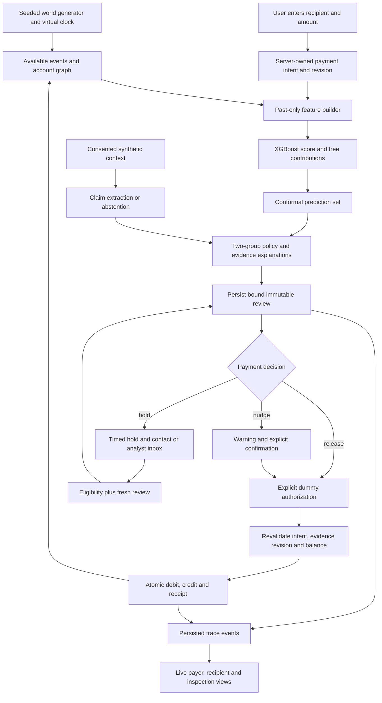

# MAYA: execution plan for an interactive payment simulator

Prepared 22 October 2026. Status: implementation specification, not a claim that
the planned functionality has shipped. Scope: improve the existing repository
into a complete, inspectable, repeatable demonstration.

## 1. The outcome

A visitor opens a clean UPI-style wallet, chooses a synthetic recipient, enters
an amount, reviews the payment, and confirms a dummy transfer. MAYA evaluates
the actual intent against generated history and evidence. The visitor sees a
receipt, a warning, or a reversible hold. Every decision can be opened to show
the input events, feature calculations, inference, signal groups, policy branch,
and resulting ledger entries. A second browser can act as the recipient or
trusted contact and see updates from the same backend.

The defining requirement is causality: changing data must change the computation,
even when it does not change the final action. No scenario name, route, button,
or frontend variable may select the model score, conformal set, or action.

This is a local payment-rail simulation using dummy balances. "Real time" means
live backend processing and cross-view updates, not NPCI connectivity. No payment
provider, real bank account, or real UPI PIN is needed.

## 2. What was inspected

Source deck: `C:/Users/ashrith/Downloads/Projects/NIT Warangal-sazi-maya.pdf`.
All 21 pages were text-extracted; selected journey, UI, architecture, safety,
and results pages were rendered and visually inspected. Page numbers below
refer to PDF pages, including appendix pages.

Repository: `aldenantonythalachira/maya-fraud-detection`, local branch
`codex/payment-review`. Existing uncommitted payment-review work must be preserved.
The inspection covers the local checkout, not a fresh audit of remote GitHub.

| Existing component | Evidence in the checkout | Action |
| --- | --- | --- |
| Journey generation and past-only batch features | `src/journey_generator.py`, `src/features.py` | Reuse; build a matching online path |
| XGBoost, conformal sets, SHAP | `src/train_xgb.py`, `src/conformal.py`, `src/reasons.py` | Preserve; version all artifacts |
| Pure two-group policy | `src/policy.py` | Preserve the four-field `decide()` contract |
| SQLite review service | `src/payment_review.py` | Extend operation binding and atomic execution |
| Consent, exact claim spans, abstention | `src/claims.py` | Preserve; label grammar limitations |
| Legacy scenario UI | `ui/app.py` | Keep as legacy; pinned results cannot enter the new demo |
| New debugger | `ui/payment_debugger.py` | Keep as internal reference during migration |
| Fixed scenario evidence | `src/demo_scenarios.py` | Retain only for named regression fixtures |
| FRI, MuleHunter, NCRP adapters | `src/integrations.py` | Keep visibly synthetic; replace account lookup shortcuts in the live demo |
| GNN and federated experiments | Separate scripts | Keep off the payment critical path |

Verification performed for this plan: 19 regression tests passed; the policy's
20 built-in cases passed. These checks establish existing behavior, not future
wallet settlement, UI quality, feature parity, or detection accuracy.

The largest technical gap is feature inconsistency. The current review adapter
mirrors sender/receiver columns and approximates several training features.
For example, its probe count spans all available outgoing history rather than
tiny payments to the same counterparty within one hour. Live inference over
different feature semantics is insufficient, even if the model call is real.

## 3. Deck-to-delivery contract

| Deck idea | Pages | Concrete implementation | Proof in demo |
| --- | --- | --- | --- |
| Ramesh's journey, small profit then escalating asks | 3, 12 | Generated temporal events with separate attempted and settled payments | Scrub timeline and inspect evidence eligible at each decision |
| History, graph and probing | 5, 12 | Independent endpoint features from event history; report-aware graph traversal | Expand a feature to its formula, time window and source events |
| Uncertainty and two-signal safeguard | 5, 8 | Actual calibrated prediction set plus unchanged independent-group hold rule | Display active groups and the selected policy branch |
| Three plain reasons | 6 | Compute actual tree contributions; add separately labeled policy/evidence explanations | Each reason links to a feature and eligible evidence |
| Stage bar | 6, 13 | Show only with consent and supported stage inference | Unsupported text shows unknown; no scripted progress bar |
| Priya and analyst paths | 3, 8, 13 | In-app trusted-contact inbox; analyst view for holds above INR 100,000 | Open a second view; observe the same payment and hold |
| FRI, MuleHunter, NCRP | 4, 9, 14 | Explicitly synthetic provider responses with timestamps and provenance | Response can be inspected; delayed/unavailable states work |
| Evidence log and replay | 11, 13 | Immutable decision snapshots plus append-only execution events | Replay the original; run changed evidence as a separate evaluation |
| Honest look-alikes, later-day evaluation, three seeds | 7, 16, 17 | Held-out journeys plus matched baseline comparison | Export actual results, denominators and failed targets |
| Voice, multilingual chat, GNN, federated privacy | 7, 8, 15, 18 | Separate research milestones after the complete payment flow | No feature advertised as trained or secure before its own evaluation |

Important scope differences must be visible in the README: the deck mentions
Flutter; this plan proposes a responsive browser app for fast local access and
two-view demos. The present claim parser is narrow English grammar, not a trained
multilingual five-stage model. Local shared-text processing is not proof of
production on-device inference. Model-margin averaging in the federated script
is not secure aggregation, differential privacy, or a production FedAvg system.

## 4. Architecture and execution flow

Use React + TypeScript + Vite for the mobile-first payer and inspection UI;
FastAPI for typed payment operations and event streaming; retain Python for the
existing risk pipeline and SQLite for the local event store and ledger. Pin
compatible versions at implementation time. Reuse existing code behind service
interfaces rather than rebuilding the risk model in JavaScript.



Use HTTP for commands and Server-Sent Events for ordered backend updates. Events
must follow successful persistence. Never implement the visible trace with
timeouts that reveal prewritten steps. Client animation can interpolate motion;
only actual server events advance status. Browser reconnection resumes after the
last event sequence; missed events can also be fetched through an HTTP endpoint.
FastAPI documents SSE in its [official tutorial](https://fastapi.tiangolo.com/tutorial/server-sent-events/).

Recommended new boundaries:

```text
api/                       typed HTTP routes, session binding, SSE
web/                       payer, recipient, contact and inspection screens
src/simulation/            seeded worlds, clock, event generation, providers
src/online_features.py     feature computation sharing batch semantics
src/ledger.py              balances, reservations, atomic settlement
src/trace.py               persistent stage events and provenance
src/payment_review.py      existing review orchestration, extended
tests/                     invariants, feature parity and integration checks
web/e2e/                   complete browser journeys
scripts/                   bootstrap, demo startup and evaluation
docs/                      contracts, runbook, measured results
```

## 5. A simulation that runs again every time

1. **Create a world.** Default to a new random seed. Generate synthetic accounts,
   opening balances, recurring payees, varying histories, counterparties, graph
   edges, report delays and scenario parameters. Save the seed and generator version.
2. **Generate causes, not verdicts.** A scenario config controls distributions:
   transfer frequency, amount growth, report delay, network structure, shared
   messages and context flags. It cannot supply risk scores or policy actions.
3. **Run the clock.** Persist event time and availability time separately. A past
   payment or report can affect a review only if both times precede evaluation.
   Equal-time events stay outside the feature snapshot. Show excluded events
   only in an explicit omniscient simulator view, never as decision evidence.
4. **Accept arbitrary user input.** Resolve only synthetic VPAs; changing amount,
   recipient, context consent or evidence availability triggers a new review.
   Unknown recipients yield an explicit unknown state, not invented history.
5. **Recompute.** Build all 18 features from the payer and recipient histories;
   run the actual model, calibration, SHAP and policy. Handle missing history
   consistently with training; do not silently replace missing values with safety.
6. **Mutate the world through settlement.** Only committed transfers alter
   balances and payment-history features. An attempted or blocked transfer can
   be logged as an attempt but cannot masquerade as a settled probe payment.
7. **Repeat or replay.** New seed produces a new world; same seed, generator,
   initial clock, artifacts and command sequence reproduces the semantic result.
   Runtime UUIDs and measured latency may differ; identify stable logical events
   separately. Preserve original timestamps for exact snapshot recomputation.

Provide controls for new seed, replay seed, advance time, add a report, delay a
feed, and generate the next journey event. These are world mutations. Remove
"force hold", manual conformal sets and manual feature sliders from the payer
flow. An advanced policy laboratory may expose them only as labeled unit inputs.

Feature parity is a merge gate: batch and online values must agree on the same
time slice, including both endpoints, business-account exclusions, seven-day and
fourteen-day windows, same-payee one-hour probes, missing history, directed graph
reachability and report availability. First preserve documented batch semantics;
any intentional correction requires retraining, recalibration and new versions.

## 6. Real-time dummy payment behavior

### Payment screens

Home -> choose/search recipient or scan an in-app demo QR -> enter amount ->
review recipient and debit direction -> MAYA result -> dummy authorization ->
processing -> receipt -> transaction details.

Use INR with correct grouping, recipient avatar and resolved display name,
masked synthetic account, available dummy balance and one obvious primary action.
The recipient sees the matching credit through the same backend event stream.
An in-app QR contains only a simulator URL/reference, not a live `upi://pay` link.
Camera scanning is optional; image upload and manual code entry must also work.

Use a clearly labeled **Demo authorization** confirmation or demo-only keypad;
never request, store or log a real UPI PIN. Incoming credits do not ask the
recipient to authorize an outgoing payment. The refund example should make this
direction distinction obvious; NPCI's [fraud-awareness guidance](https://www.npci.org.in/fraud-awareness)
specifically explains the payment-versus-receipt distinction.

### Money and state invariants

- All amounts are integer paise. Each settlement has one debit and one equal
  credit under a unique transfer ID; net ledger movement is zero.
- Opening funds are explicit genesis ledger entries. Balances are derived from
  the ledger; available balance also subtracts active authorization reservations.
- A MAYA hold blocks that intent. It does not debit the wallet or reserve funds
  for an hour. After release, authorization checks available funds again.
- Dummy authorization binds the exact operation revision. Settlement atomically
  rechecks review validity and funds. Reserve, commit, release and failure events
  cannot create a second debit or leave an unexplained balance change.
- Duplicate clicks, HTTP retries, refreshes and process restart use the same
  idempotency key and return the recorded result. Reusing a key with different
  inputs returns a conflict. Idempotency scope includes session and world.
- Timeout means pending/unknown until reconciled from the transfer ID. Never
  show failure just because the browser disconnected after a committed debit.
- Cancellation races with settlement in one database transaction: exactly one
  terminal result wins. Terminal payments cannot be edited or resent.

SQLite supports explicit transactions; concurrent writers can return busy and
need bounded handling. Process-local Python locks alone do not establish safety
across API workers. Start with one API worker and test separate DB connections.
See [SQLite transaction documentation](https://www.sqlite.org/lang_transaction.html).

### Review binding and hold semantics

Extend existing binding to include world ID, context/consent revision, feature
schema, provider/evidence snapshot version and server decision expiry, in addition
to payment, payer session, recipient, amount, direction, operation revision and
model/calibration/policy hashes. Execute against persisted server state, never a
client-submitted action. New relevant reports invalidate or refresh the review
under a documented snapshot-version check. Identical irrelevant feed updates
should not invalidate every payment globally.

Preserve the current two-group safeguard. Multiple history features form one
history group; several messages form one soft group. A model score is not an
independent group. `{fine}` releases under the core policy; the enhanced review
may add a contradiction nudge, as currently implemented, without turning it into
an unsupported hold. Show that distinction in the trace.

The deck conflicts on bypass and automatic release. Resolve using the existing
repository specification: nudge can be explicitly confirmed; active enforced hold
can be cancelled; at one hour it becomes eligible for fresh review, not an
automatic transfer. Above INR 100,000, simulated analyst approval is also needed
for that exact revision. Contact acknowledgment does not authorize settlement.
Show the countdown using server time and a clearly labeled virtual-clock control.

Implement one unsolicited alert per payer per simulated day with durable
deduplication. Required transaction status and an existing hold remain visible;
the alert budget must never make a held payment executable. A trusted-contact
notification is an in-app synthetic inbox event with consent, never a real SMS.

## 7. Clean UI with transparent inspection

Use a light neutral background, dark text, a single restrained brand accent,
consistent spacing and rounded payment cards. Keep the payer screen narrow and
mobile-first; on desktop, the inspector can sit alongside it. Use familiar UPI
interaction patterns with original MAYA branding. Avoid dense dashboards on home.

| Screen | Primary content | Primary action |
| --- | --- | --- |
| Home | Dummy balance, send/receive, recent recipients and actual history | Pay someone |
| Recipient | Search or demo QR; resolved synthetic identity | Continue |
| Amount | Large numeric input, recipient and available funds | Review payment |
| Review | Amount, payee, debit direction and up to three supported reasons | Continue / Confirm warning / Cancel held payment |
| Authorization | Exact dummy transfer summary; demo-only confirmation | Authorize demo payment |
| Processing | Actual server status, recoverable connection errors | View status |
| Receipt | Amount, parties, timestamp, transfer ID and dummy balances | Done |
| Hold | Reason, server countdown, cancel, trusted-contact status | Cancel payment |

Put **See how MAYA decided** on review and receipt screens. The inspector has:

- A live stage sequence: input validated -> history loaded -> features computed
  -> inference -> uncertainty -> policy -> review persisted -> settlement.
  Failed stages show real errors; unfinished stages stay pending.
- A lineage table: feature, value, formula, window, event IDs and eligible times.
- A real graph with evidence-backed edges and report provenance. No fabricated
  scam network appears just because a scenario is called investment.
- Actual model score and SHAP contributions in demo inspection only, with
  separate labels for policy templates and provider facts. Fewer than three
  supported reasons is better than filler. SHAP describes contribution, not guilt.
- Model and feature versions, policy branch, group truth table, elapsed times,
  review revision, transfer state and balanced ledger entries.
- Original snapshot download and linked counterfactuals. "Delay report" changes
  available data and recomputes; it does not edit the recorded original outcome.

Use persistent stage events with `world_id`, `payment_id`, `review_id`,
`sequence`, `stage`, `status`, wall/virtual time, monotonic duration, input/output
references and error code. Do not include secrets or unconsented raw text.
Hashing detects accidental modification; do not call the current local digest a
cryptographic signature or protection against an administrator rewriting the DB.

Accessibility gate: keyboard-complete flow, visible focus, large tap targets,
screen-reader status announcements, sufficient contrast, reduced-motion support,
and layouts checked at 360px, 390px, 768px and desktop width. Never use color alone
to communicate success, warning or hold.

## 8. Ordered execution backlog

Planning estimate: 12-15 focused engineering days for one experienced full-stack
developer, including stabilization, assuming the current model artifacts work.
This excludes training and validating multilingual/voice models. Shorten scope
if the deadline is 48 hours; do not represent that cut as the full deck.
Every stage is a reviewable feature-branch PR; keep main untouched until review.
Finish and validate the existing payment-review branch before dependent work.

| Stage | Budget | Deliverable | Required exit check |
| --- | --- | --- | --- |
| 0. Preserve and baseline | 0.5 day | Review existing uncommitted work, pin setup, record artifact/schema hashes, finish debugger check | Existing tests, policy self-test, inference startup and documented run command pass |
| 1. Event world | 1.5 days | Seeded world generator, virtual clock, temporal event schema, synthetic provider feeds | Same-seed semantic replay; different seeds vary inputs; future events excluded |
| 2. Feature correctness | 2 days | Shared batch/online definitions and versioned feature snapshots | Batch/online parity on randomized histories, both endpoints and all boundaries |
| 3. Wallet and execution | 2 days | Genesis funds, ledger, authorizations, idempotency, review/evidence binding | Conservation, insufficient funds, retries, restart and separate-connection races pass |
| 4. API and events | 1 day | Typed HTTP contracts, payer/session/world isolation, persistent SSE trace | Two browsers observe one result; reconnect misses no committed events |
| 5. UPI-style payer | 2 days | Home, recipient, amount, review, authorization, receipt, history | User completes a free-form dummy transfer; recipient credit and balances reconcile |
| 6. Intervention and inspector | 2 days | SHAP lineage, graph, countdown, contact inbox, analyst actions, immutable replay | Every displayed fact traces to evidence; stale/reused approvals rejected |
| 7. Evidence and release | 1-2 days | Held-out evaluation, latency report, responsive QA, startup script, runbook and demo | Acceptance matrix passes; metrics exported; another person runs from a clean clone |

Dependency chain: 0 -> 1 -> 2 -> 3 -> 4 -> 5 -> 6 -> 7. Visual design and API
contracts can be drafted earlier; do not connect a polished UI to fixture verdicts
while waiting for the real service. Do not add cloud services to the critical
path of a local, repeatable demo.

Proposed API contract: create/reset world; resolve recipient; read balance;
create/edit intent; review intent; authorize/execute/cancel; read transfer status;
list history; read/download/recompute review; stream/fetch ordered events;
advance simulator time; acknowledge contact alert; record simulated analyst action.
The browser never sends feature values, model scores or final actions.
Restrict simulator clock/feed mutation to the demo controller role. The demo's
session roles are not production bank authentication; document this boundary.

## 9. Acceptance matrix: hard release gates

| Challenge | Required observation |
| --- | --- |
| Familiar rent / INR 40,000 to family | Uses real available history and scoring; no forced release based on amount or label |
| Investment escalation | Generated earlier credits/payments and graph links explain the computed result; unexpected outcomes remain visible |
| Refund message | Incoming promise versus outgoing operation is shown; soft evidence alone never holds |
| New legitimate merchant / wedding expense | High amount alone is insufficient to invent fraud or reported links |
| INR 1, 2, 5 probes | Same-payee settled probes affect the one-hour feature; other payees and expired probes do not |
| Change amount or recipient after review | Old review rejected server-side, including edit-away-and-back |
| Change consent or relevant report after review | Stale context/evidence rejected or atomically refreshed before authorization |
| Duplicate submit / two browser tabs | One settlement, one debit and one matching credit |
| Two API connections and competing spends | No overdraft or duplicate execution; bounded busy errors recover cleanly |
| Refresh or restart after debit | Existing transfer recovered; no replayed debit or false failure |
| Active hold / cancel / expire | No debit during hold; terminal cancellation; expiry requires fresh review and confirmation |
| Analyst threshold | Exactly INR 100,000 versus above-threshold behavior follows the strict boundary |
| Delayed report | Cannot influence an earlier review; later evaluation links to the unchanged original |
| Unclear text / unavailable provider | Explicit abstention or unavailable state; no fake clean verdict |
| Model missing or inference failure | Explicit degraded/unavailable result; no canned success or stale score |
| Replay | Matching versions reproduce the outcome; mismatched artifacts reject recomputation |
| New seed | Different histories, IDs, graph or amounts; the same actual computation path still runs |

Add tests only where they establish behavior: shared feature parity, financial
invariants, temporal leakage, concurrent execution and full browser journeys.
Do not substitute screenshots or fixture adapter tests for model-driven coverage.
The current 19 tests use fixtures for several policy paths; preserve them and add
separate integration tests using generated worlds and the actual model.

## 10. Evaluation and honest claims

Run the preserved baseline and enhanced policy on identical held-out intents,
available evidence and time boundaries. Use at least three recorded generator
seeds, disjoint temporal splits and one whole scam type held out from training.
Freeze tuning before test evaluation. Include hard benign look-alikes, sparse
history, absent reports, provider failures and unsupported language.

Export sample sizes, scam journeys and legitimate payments per split; PR-AUC;
recall at a validation-chosen 1% FPR; actual benign interruption rate; stopped
fraud amount; interruption cost; stage-to-intervention timing; class-conditional
and marginal coverage; contradiction precision and abstention; false holds; alert
deduplication; feature parity; replay fidelity; and invalid-review rejection.
Count fraud money stopped only when the simulated transfer was actually prevented
and that amount was otherwise attempted. Trusted-contact delivery is not money saved.

Targets from the deck remain targets: p95 150ms hot path, 90% coverage, alert
budget and fairness gaps. The local smoke calibration is approximately 85.83%
coverage according to existing artifacts/logs, below target; do not display a
90% guarantee. Investigate class-conditional calibration with enough positives,
retrain/recalibrate on separate splits and report confidence intervals. Marginal
coverage alone is inadequate under extreme class imbalance.

Measure feature lookup, model, SHAP, calibration, policy, DB commit and total
request latency separately on stated hardware, sample count and warm/cold runs.
Report total user-visible duration too; never mix staged animation or user think
time into model latency. If explanations exceed budget, report that and optimize
measured work; do not claim a fast end-to-end path using model-only timing.

The appendix B4 numbers are historical synthetic results with roughly 30 scam
journeys per test, not a guaranteed outcome for this implementation. Age/language/
device fairness is inconclusive when subgroup support or real signal models are
missing. Do not certify fairness using arbitrary synthetic demographic tags.
The current attack script's text-only comparison includes an assumed evasion
constant; replace it with measured attacks before claiming comparative robustness.

## 11. Demo script, delivery and deadline cut

Five-minute live demo:

1. Start a fresh world with its seed visible. Make a free-form familiar payment;
   see real dummy balance movement and a recipient credit.
2. Generate an investment journey. Show eligible history, edit the amount, and
   observe actual recomputation. Explain whichever action the model produces.
3. Open the inspector: follow one graph edge and one feature back to their events;
   show the uncertainty set and independent-group decision.
4. Try an old review after changing recipient. The server rejects it. Then delay
   a report in a separate evaluation and compare the immutable original.
5. Show a hold/contact path, advance the virtual clock, obtain a fresh review,
   and demonstrate cancellation or analyst-gated eligibility. End with a new
   seed and replay/download to establish repeatability.

Saved regression seeds may demonstrate known paths if visibly labeled. Every run
still executes the generator and model. Never filter away awkward random results
while claiming an unbiased live demo.

Ship a single startup command, reproducible dependency locks, deterministic smoke
artifact bootstrap, readiness checks, isolated per-world database namespaces,
artifact manifest, architecture diagram, API contracts, test/evaluation outputs,
limitations, recorded backup demo and a clean-clone runbook. Generated datasets,
model outputs, SQLite files and scratch renders stay ignored. Preserve the old
working demo until the new flow passes all core gates.

For a strict 48-hour deadline, scope down to: feature-correct generated worlds,
one dummy payer and recipient, actual inference, atomic wallet transfer, review
invalidation, three payer outcomes, persisted trace and seed replay. Use manual
recipient entry; defer camera QR, rich stage inference, voice, multilingual
training and cloud deployment. Keep the compact mobile layout and clear receipt.
This is a reduced delivery, not a claim to complete every deck component.

## 12. Follow-on research after the core passes

Train and benchmark a multilingual stage model before showing five-stage
confidence. Evaluate synthetic shared voice notes before advertising anti-spoofing.
Time-slice the GNN and compare on the same target and later-time evaluation;
the existing transaction-model and account-model AUCs are not directly comparable.
Treat genuine federated training, privacy accounting, secure aggregation,
cryptographically signed evidence and bank integrations as independent projects
with their own threat models, datasets and validation. None is a prerequisite
for proving the complete local payment, detection and explanation loop.
