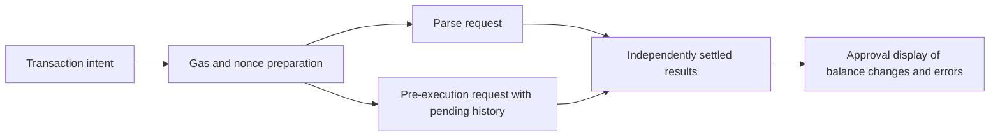

# Finale behavior and acceptance criteria

The existing detector remains the scoring engine. The payment service is a local
simulation, not a bank/UPI connector. External fraud feeds and all demo identities
are synthetic. A fixture result must never be presented as model inference.

## Payment review

- Store amounts as positive integer paise. Bind each review to payment ID, payer
  session, recipient, direction, amount, revision, expiry and model/policy versions.
- The service owns the current operation. Changing it increments its revision.
  Execution compares its current operation with the saved review atomically;
  stale, expired, wrong-session and reused decisions cannot execute a payment.
- Cancelling a payment is terminal. Completing it is terminal. Reviews are not
  payment authorization credentials outside the in-process simulator.
- Nudge requires an explicit confirmation. A hold supports cancellation and
  expires after one hour; expiry makes it eligible for a fresh review, not a
  silent money transfer. Above INR 100,000, analyst approval is additionally
  required. A change of operation invalidates that approval too.

## Claim and evidence

- Start with voluntarily shared synthetic text, deterministic extraction and
  fixed explanation templates. No LLM controls a hold or generates alert text.
- Identify exact supporting spans; abstain on unknown/ambiguous language.
  Outgoing payment vs promised incoming refund is a contradiction. Paying an
  investment release fee is an outgoing operation with an unverified future
  benefit, not a direction contradiction. A booking deposit can be consistent.
- The prototype runs locally; it does not establish production on-device
  deployment or collect screen contents. Only consented text is processed.
- Semantic evidence is one soft group. Multiple phrases do not become multiple
  independent groups. A hold needs history+recipient or hard+soft evidence.
- Use event time and availability time. Evidence is usable only when both are
  strictly before evaluation. Future reports cannot influence past features.
- Each displayed graph edge must exist in the available evidence. Labels such
  as confirmed fraud require the matching report; missing evidence is unknown.

## Replay and challenges

- Persist the original payment, available evidence, feature snapshot, model,
  calibration and policy versions, score, uncertainty, action and reasons.
- Original replay preserves the record; recomputation verifies the recorded
  result with matching versions. A changed recipient or delayed report produces
  a separate evaluation linked to its parent. Never overwrite the original.
- Demo acceptance: benign rent; investment journey; refund contradiction;
  recipient/amount change invalidates review; delayed report changes eligible
  evidence naturally. Do not force the changed result to remain fraud.

## Evaluation

Compare baseline and enhanced policies on the same held-out inputs. Report sample
sizes, extra scam detections, benign warnings/interruptions, contradiction
precision, extraction abstention, p95 latency, stale-review rejection and replay
fidelity. Behavioral fixture tests are not held-out accuracy measurements.
Keep all new measurements separate from historical synthetic B4 results.

## Rabby source study

Inspected commit `c3aed73f4c5f1e7c88c31331b0b0b72c6e8f2f4a` on 2026-10-20:

- [signTxPreparation.ts](https://github.com/RabbyHub/Rabby/blob/c3aed73f4c5f1e7c88c31331b0b0b72c6e8f2f4a/src/background/service/signTxPreparation.ts):
  `startSignTxPreparation` prepares gas/nonce and pending history before calling
  parse/pre-execution services. It checks cancellation, settles requests
  independently, and expires the preparation map entry after 60 seconds.
  `getSignTxPreparation` returns undefined for failed subresults and consumes
  the map entry. Cancellation marks state and removes entries.
- [BalanceChange.tsx](https://github.com/RabbyHub/Rabby/blob/c3aed73f4c5f1e7c88c31331b0b0b72c6e8f2f4a/src/ui/views/Approval/components/TxComponents/BalanceChange.tsx):
  renders incoming/outgoing token and NFT changes separately, version-specific
  unsupported/error states, and no-change state; absent data returns no display.

This is a narrow source-level workflow study, not an end-to-end execution trace.
The display receives balance-change data; wiring across other files was not
audited. Preparation expiry is not proof that Rabby enforces MAYA's revision
binding. That invariant is our own implementation requirement. No Rabby source
is copied, and no claim is made to reconstruct its backend or NPCI settlement.
REA was suggested in the supplied context but was not used for this inspection.
