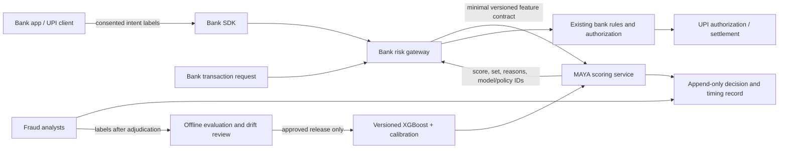

# MAYA shadow-pilot blueprint

## Pilot objective

Measure whether MAYA's explanation and review workflow adds useful warning signal for a bank's fraud team, without changing payment authorization. A bank remains the system of record and makes every allow/decline decision.

## Proposed first deployment

- **Owner:** one bank's fraud-risk product owner, with security, privacy, UPI operations and customer-support reviewers.
- **Mode:** four-week shadow pilot after a data-sharing agreement, threat model, DPIA/privacy review and incident runbook. Analysts label sampled cases; MAYA does not block or delay live payments.
- **Integration:** a bank-owned server call before its existing authorization decision. A bank/mobile SDK may send only approved, consented derived labels. No companion app can intercept another UPI app.
- **Budget:** proposed 150 ms end-to-end risk-advice deadline, including network overhead. This is an integration target, not a current production measurement. On timeout or MAYA failure, the bank's existing decision path continues (fail open to existing controls, not “approve” by MAYA).
- **Scale:** start with a fixed low share and ramp only after latency, error, queue, privacy and analyst-capacity gates pass. Use bank-owned limits, circuit breakers and kill switch.

## Data contract and provenance

| Signal | Likely source | Pilot condition |
|---|---|---|
| Amount, time, transaction direction/type | Bank/PSP transaction request | Available before decision; schema and currency validated. |
| Prior payer/payee counts and totals | Bank's authorized feature store | Point-in-time query, no future/current outcome leakage; freshness and outage behavior measured. |
| Recipient complaint/report flag | Bank-approved fraud/reporting system | Include source, effective time, expiry and correction path; a flag alone is not a fraud verdict. |
| Device/session risk | Bank app SDK or bank risk service | Explicit purpose, minimization and user notice; MAYA never reads another app's private data. |
| Message/call context | Optional on-device classifier | Send only a coarse consented label; raw chat/audio never leaves device. Exclude until separately validated. |
| Merchant confirmation | Bank/PSP settlement status | Treat only committed transaction status as proof of credit; screenshots and soundbox claims are not ledger truth. |

Each feature needs an owner, timestamp semantics, missingness code, allowed purpose, retention term and validation test. Unknown/missing bank facts must lead to explicit abstention or the bank's existing rules, never a fabricated score.

## Serving and safety boundary

The production proposal starts with a bounded CPU scoring path and asynchronous analyst/audit work. GNN, federated and deep models remain offline challengers until they beat the same source-matched baseline on later-time data, meet latency and availability gates, and have an explainable fallback. No external LLM is placed on the payment path.

## Scale measurements required before ramp

The repository contains a short local SQLite measurement (25 successful full reviews/s, p95 37 ms on a 16-logical-CPU Windows host; 50/s offered caused rejections and p95 229 ms). Treat it only as a starting observation: the service serializes some database work and the run does not model a bank gateway or production PostgreSQL cluster. Do not multiply it linearly into national TPS.

For the pilot, benchmark the target PostgreSQL deployment at realistic request mix and database/network conditions. Record successful RPS per allocated vCPU, p50/p95/p99, 429/5xx/timeouts, queue depth, memory, DB connections, cache hit rate and feature freshness. Use the measured saturation point with an agreed headroom factor to size instances; load-test failover and rate limits before traffic. Estimate `instances = ceil(target_RPS / measured_safe_RPS_per_instance)` only after defining “safe” from zero-error latency/availability gates.

The synthetic candidate fast path (known payer/payee + low amount) is measurement-only. Do not bypass the model or bank controls until a separate, source-matched test shows the eligible share and scam miss rate are acceptable.

## Pilot gates and ownership

1. **Before data access:** signed authorization, threat model, data dictionary, consent/retention terms, DPIA and security review.
2. **Offline baseline:** chronological split, 3 seeds, held-out scam-type test, lookalike slices, class-wise precision/recall, PR-AUC, recall at a fixed FPR, confidence intervals and calibration. Include cold start and missing-feature results.
3. **Shadow launch:** bank's existing rules only control money; MAYA advice is invisible to users at first. Compare against the incumbent baseline and analyst labels.
4. **Human review:** staff capacity, clear reason source (model/rule), correction and appeal flow, stale-review rejection, false-positive clear-time and escalation ownership.
5. **Ramp decision:** bank risk owner signs off on quality, privacy, p95/p99, uptime, safe throughput, incident response and rollback. Any material regression triggers kill switch and existing bank rules remain authoritative.

Current demo status: the product contract, synthetic ledger and local evidence are present. No bank, data-sharing agreement, server, public domain, production feature store or real transaction connection is established.
