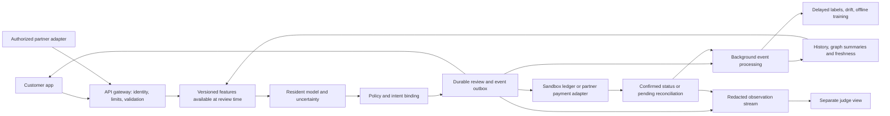

# MAYA V4: a payment-safety product people can actually use

24 October 2026 | Planning only | Active execution plan

**Product promise:** Check a payment before you trust it. Understand the warning. Choose the next step.

This replaces V3 revision 3.1 as the active build plan. It combines the original deck and rubric goals, the systematic-review audit, the latest repository changes, and the separate customer/judge experience now being developed. Prior plans remain historical references. No application changes or model results are created by this document.

## 1. What we are building

MAYA has three connected parts:

1. **Customer app:** a simple mobile experience for checking a QR, payment link or message, understanding a specific risk, and continuing through an available payment route.
2. **Safety API:** the same review engine available to the app and, later, authorized payment partners. It computes evidence, model outputs and protective advice.
3. **Judge view:** a separate, read-only page on another tab or device. It explains the actual review as it happens, without cluttering the customer's screen.

The memorable demonstration is one payment moving across these surfaces: a customer acts on a phone, evidence appears on the projected judge view, and the confirmed result reaches the recipient. Sophistication belongs in the computation and evidence; the customer sees a clear decision and a useful next step.

### Three deployment modes

|Mode|What the customer can do|What MAYA can truthfully know or enforce|
|---|---|---|
|Hackathon sandbox|Complete a dummy payment with generated history, warnings, review and a receipt|The simulator owns the ledger and can enforce its policy. Clearly label simulated money and providers|
|Public companion|Explicitly share/paste a message or link, upload/scan a QR, inspect advice and use a supported app handoff|Only shared information and authorized sources are observable. Advice cannot block a payment made directly elsewhere; a handoff does not prove payment success|
|Partner API/SDK|Receive integrated protection inside a PSP/bank-approved payment flow|Partner supplies authorized features, owns authentication/settlement, and agrees on enforcement and status semantics|

Start with a responsive web app/PWA for broad access. An Android share receiver is the next device integration if time permits; browser share-target support varies and needs a tested fallback. Native iOS integration is a separate milestone. Do not promise invisible monitoring of every UPI app or depend on screen overlays, accessibility-service surveillance or broad SMS permissions.

The primary demonstration uses the sandbox. Any real-app handoff is a separately enabled, tested route; never let dummy transactions accidentally open a live payment with real money.

## 2. Current repository: what changed and what must be joined

Remote refs were fetched and inspected on 24 October 2026. The working checkout remains `codex/decision-platform` at `72eb30e`. It is clean. These observations are source inspection, not freshly executed tests or verified CI results.

|Remote branch / commit|Observed state|Build decision|
|`main` / `f26af85`|Merged evasion hardening: 27 feature columns, cumulative-payment/pass-through signals, adversarial augmentation, held-out class-specific calibration, pytest workflow and revised research demos|Use as the integration base for current ML and policy work|
|`feature/evasion-hardening` / `b6a4b04`|Already merged into main|Do not duplicate its changes or call them new finale work|
|`codex/interactive-wallet` / `71b576c`; `codex/live-simulator` / `d90cd17`; `codex/payment-review` / `0471553`|Carry the fuller wallet/API/ledger/trace lineage, absent from current main; ML path remains the earlier 18-feature stack|Recover the required product components deliberately, rather than assume main contains them|
|`codex/finale-foundation` / `4bb71c1`|Payment-review foundation is represented in main's ancestry|Inspect ancestry before applying commits|
|`fix/smoke-ui-verdicts` / `117d05f`|Separate unmerged fixes touching overlapping ML, smoke and UI files|Review each change against main; do not merge wholesale without resolving overlap|
|Parallel judge/customer separation|User reports work in progress; not established by these inspected remote refs|Agree an interface contract and preserve that work; recheck its eventual branch before integration|

**First blocker: compatibility.** The old wallet adapter reads one `qhat` and scores 18 columns. Main now exposes a two-threshold calibration interface and 27 columns. The current main payment-review adapter also uses a simplified feature approximation, while Streamlit scenarios contain copied test-row features and optional pinned prediction sets. These are useful research tools, but cannot be the source of customer-product decisions.

Before combining branches:

- Build one live feature contract matching all required 27 training columns, endpoint roles, time windows, graph direction and missingness. Reuse exact offline definitions and check them against an independent past-only implementation.
- Update the serving adapter to the new calibration interface. Package feature schema, model, calibration and policy versions together; reject incompatible bundles.
- Preserve selected-tree SHAP consistency from the wallet lineage. Explanation reconstruction must match the score actually used.
- Re-run the relevant checks on the integrated branch. Older 18-feature recall/coverage results and newer 27-feature synthetic reports describe different artifacts and cannot be combined into one current score.
- Keep research fixtures/pinning outside the customer and official demo paths. Missing models produce an explicit unavailable result.

Use an integration branch from current main and small reviewed commits. Do not reset an existing branch or overwrite the parallel UI feature. Recheck branch heads immediately before implementation because this snapshot can change.

## 3. The customer experience

### Four screens are enough

|Screen|Visible content|Primary action|
|Home|Scan QR, check a link/message, recent checks|Start a check|
|Review|Recipient, amount, payment type, source and optional context|Check payment|
|Result|A plain-language assessment, at most two useful reasons and clear next actions|Continue, edit, cancel or request review, as policy permits|
|Activity and help|Accurate payment/check status, receipt or pending state, report/help route|View status or get help|

Settings contains language, accessibility, connected data and consent controls. Avoid adding a separate technical dashboard to the customer journey.

Use a restrained UPI-style design: generous spacing, clear recipient identity, large amount, strong primary button, consistent navigation and a small, persistent sandbox label when applicable. Do not imply bank-verified identity from a QR display name. Remove slogans, developer comments and repeated explanatory captions. Retain consent, consequences, uncertain status and critical payment details.

### Warning behavior

- An advisory warning identifies the mismatch: for example, "This sends money. The message says you will receive a refund." Offer an understandable next step, not just a score.
- A policy hold states what is required next, allows cancellation, and offers independent review where implemented. Dismissing text or moving a slider cannot release a held operation.
- A legitimate correction creates a fresh review. Binding and hold rules decide whether the operation may proceed; a new score alone does not erase an existing hold.
- With limited context, say "Limited information" or "Unable to complete this check." Avoid "100% safe" and broad recipient accusations.
- Keep receipt states distinct: check complete, opened payment app, payment pending, failed and confirmed. Only an authoritative simulator/partner status can produce a payment-success receipt.

### Accessibility is a release requirement

Target WCAG 2.2 AA for the web app. Test keyboard navigation, visible focus, screen-reader names/status announcements, text resizing, contrast and small-screen reflow. Use a 44px product target for touch controls, and never communicate risk by color alone. Provide reduced motion, plain language, back navigation and input preservation after recoverable errors.

Ship a thoroughly tested English flow and one audience-relevant Indian language if competent review is available. The chosen language must cover warnings, errors and recourse, not only navigation labels. Voice playback is optional and user-initiated; avoid cloud transmission of private text merely to add audio.

Handle denied camera permission, unreadable QR, unsupported payload, weak connectivity and return from another app. A cached offline interface must not display an old review as a fresh safety assessment. Never queue a payment for automatic execution when connectivity returns.

Run five short usability sessions with new testers, including someone unfamiliar with the project. Record whether they identify the recipient, understand the warning and find the next action without coaching. Report observed results rather than claiming a population study.

## 4. A visually compelling judge view

The separate view already being developed should consume the API's events. Its implementation owns presentation; the backend owns facts. A judge link grants observation of a specific demo session, not payment, analyst or controller privileges.

### Layout

- **Top:** current payment, assessment and final status. Show masked identities and whether data/providers are simulated, public-benchmark or partner-supplied.
- **Center:** seven stages: input → validation → available evidence → features → model and uncertainty → policy → outcome. Each stage displays pending, running, completed, unavailable or failed, plus its actual duration.
- **Side panel:** the two or three decisive observations, their source times and missing information. Distinguish observed facts, model inference and policy rules.
- **On demand:** a bounded graph of relevant payment edges, the exact feature values, model/schema versions and sanitized review export.
- **Separate benchmark tab:** frozen evaluation results with sample counts and dataset labels. A live unlabeled jury input is not counted as a correct detection.

Animate only real stage transitions. If several stages finish together, show their true timing; never insert artificial waiting to make computation look impressive. Graph edges come from recorded data, and SHAP contribution size is not a causal probability or proof of fraud.

### Cross-device contract

Use `session_id`, `payment_id`, `review_id`, intent revision, ordered event sequence and server timestamps across app, service and judge view. A review ends in one terminal event, including failure. Reconnect resumes from a cursor and deduplicates; selecting an older review remains visibly historical.

Use expiring, revocable, read-only session grants, exchanged into a protected browser session. Keep access tokens out of logs and third-party referrers. Provide a pairing code or QR for the judge device, limited to the intended session. Start cross-device tests on a protected HTTPS deployment; `localhost` on another phone refers to that phone, not the laptop server.

Judge exports contain sanitized evidence and version references, not raw private messages or other customers' histories. Hiding buttons is insufficient: direct API calls must also reject observer mutations and cross-session access. Analyst actions use a separate authorized identity. The customer cannot grant themselves analyst privileges.

**Parallel-work handoff:** agree the event schema, URL/session pairing, role permissions, result vocabulary and five test cases before the two implementations diverge. Use fixtures for layout development only; final acceptance runs against the integrated live service.

## 5. The model system behind the simple interface

Use a layered decision system. Complexity earns its place through measured value.

|Layer|Computation|Availability and promotion rule|
|Input and intent|Bounded QR/link parsing; operation/amount/recipient extraction; optional consented message analysis|Malformed input and unsupported language can abstain; no arbitrary URL fetching|
|Transaction behavior|Current 27-feature XGBoost, including payment splitting/cumulative amount and pass-through patterns|Only where the complete feature-availability contract is satisfied|
|Uncertainty|Held-out class-specific conformal sets; separately evaluated probability calibration|Show class support and coverage; drift weakens assumptions. A model score is not automatically a calibrated probability|
|Network context|Past-only graph witnesses and bounded cached account summaries|Authorized graph sources, source-root deduplication and freshness required|
|Policy|Existing four-field `decide()` contract and two-group hold safeguard, plus separate authorization eligibility checks; the interactive sandbox gives a non-blocking prompt when eligible event lineage contains no prior successful outgoing payment|A missing-history prompt never creates a hold. History is determined from eligible events, not from `n_t` (which counts recent first-seen counterparties); neither certainty nor several models reading one event create independent corroboration|
|Explanation|Evidence-backed reasons and model-specific attribution|Tie to the exact input, selected model and policy version|

The public companion usually lacks bank history and recipient flows. It must use a separately trained/evaluated context-only or partial-input route; it cannot fill missing behavioral features with zero and run the full model as if data were present. Until that route is validated, offer bounded parsing/intent assistance and an explicit limitation rather than an unsupported fraud score.

### More advanced models

After the base product works, compare **one** compact sequence model or contextual encoder on data that supports its task. A GRU/LSTM needs real prior sequences. A text encoder needs representative intent labels and multilingual/benign evaluation. Public SMS spam labels do not supply UPI coercion labels. Keep user text as untrusted input; an LLM cannot execute tools, authorize payment or override policy.

GraphSAGE belongs in the background as a candidate account-risk model, not a full graph computation on every payment. Current main improves training/validation snapshots, but its test snapshot still includes full-history edges: that is retrospective evaluation, not event-time serving proof. The documented two test mules are too few for a convincing generalization claim. Build more independent campaigns and event-time tests before promotion.

The federation module is an output-ensemble simulation, not a deployed privacy-preserving training network. Keep it as optional related work. Prioritize a demonstrable model gain, reliable explanations and user outcomes over extra architectures.

The current adversarial code is useful, but its feature-row perturbations include approximations. Add transaction-event attacks that regenerate history and recompute features. Hold out attack families and campaigns, test benign lookalikes and report model-level detection separately from policy interventions.

## 6. Data and evaluation

Keep three clearly labeled evidence sets:

1. **Generated demo worlds:** coherent accounts, histories, reported events and ledger state. A seed reproduces the world; it must never select a verdict.
2. **PaySim external benchmark:** public synthetic mobile-money data with its own adapter/model. Preserve checksum, terms, source, actual counts and split manifest. Do not relabel its currency, invent linked messages or turn labels into reports.
3. **Unseen scenario kit:** independently authored QR, intent, privacy, recourse and safety cases. Optional public SMS data tests a separate spam task only.

For PaySim, exclude labels/flagged-fraud fields, post-transaction balances and balance differences unavailable before authorization. Group histories by account, use only earlier complete hourly steps, and keep whole steps in chronological splits. Freeze train/validation/calibration/test assignments before tuning. Fit preprocessing/resampling on training only; preserve evaluation prevalence. Do not force PaySim into the 27-feature UPI-like schema.

Reproduce current-main and wallet baselines separately, then evaluate the integrated bundle. Compare rules/logistic regression/XGBoost and one justified candidate on the same eligible cohort, features and tuning budget. Select thresholds before final testing under a declared benign-intervention budget.

Publish PR-AUC, recall, precision, benign intervention rate, confusion counts, uncertainty coverage by class, unsupported-input rate and support/intervals. Add correction success, time to understand an alert and completion rate for benign journeys. Zero false positives in a small sample does not establish a tiny production rate.

Model recall, policy hold rate, recovered money and user comprehension are different outcomes. Neither near-perfect synthetic accuracy nor literature percentages prove real-UPI performance. Online feedback enters a label store with authority, maturity and corrections; it does not trigger automatic retraining or become verified fraud because a user dismissed an alert.

## 7. Service architecture and high traffic

### API contract

Expose a versioned service boundary, proposed as `/v1/checks`, `/v1/checks/{id}`, `/v1/checks/{id}/events` and `/v1/cases`. Sandbox payment execution is a separate namespace and deployment mode. These are proposed routes; the existing wallet has `/api/worlds/...` routes.

Requests carry tenant/source, idempotency key, intent revision, operation, amount/currency, tokenized participants, available evidence with observation/availability time, consent scope and deadline. Clients cannot submit their own trusted feature values or provider verdicts. Responses include check status, advice, short reasons, information completeness, evidence/model/schema/policy versions, expiry and exact intent binding.

An identical idempotent retry returns the original result; a conflicting payload is rejected. Changed recipient, amount, operation or schedule requires a new bound review. A signed review is not settlement authorization and cannot force an external app to preserve its fields; the partner/sandbox executor must recheck binding.

### Fast path versus background work

Keep resident inference, bounded feature reads, policy evaluation, minimal reasons and durable review/outbox commit in the fast path. Put graph construction, model training, deep enrichment and bulk exports in the background. Rich explanations can follow with the original pinned versions. Never wait for an unrestricted remote LLM call before every payment.

The local SQLite wallet is a demo baseline. For a multi-user pilot, move authoritative review/payment state to a transactional database such as PostgreSQL, add migrations, pooled connections, tenant isolation and a durable outbox. Use Redis only for bounded counters/cache, with defined freshness and correction rules. Add a broker when measured delivery/throughput needs justify it. Do not claim a cloud service list proves capacity.

Keep scoring replicas stateless and prewarmed. Coordinate per-account feature updates with event time, deduplication and version checks; cross-account features need coherent snapshot semantics. Use bounded queues, tenant quotas, retry budgets and load shedding. Scale from queue age, p99 latency and resource saturation with spare capacity.

The judge stream is a separate workload: subscribe only to the selected session, bound replay and fan-out, and aggregate general traffic. A slow projector must not slow payment review. Retain the full mandatory decision record independently of optional animation/diagnostic sampling.

### Capacity proof

Treat 50ms as a warm-service stretch budget and ≤150ms p95 as an initial objective for a declared workload; report p99 and failures. These are proposed engineering targets, not current measurements or UPI obligations. Include feature reads, policy and durable writes in service timing; measure network/device time separately.

Run an open-loop load ladder at 1, 10, 25, 50 and 100 checks/second locally, stopping at saturation. Use unique intents, realistic payloads, hot accounts, bursts, cold starts, provider outages, retries and process restarts. Publish hardware, data size, concurrency, throughput, p50/p95/p99, errors, queue age, cost and recovery behavior. Add distributed 1,000/5,000/10,000 checks/second experiments only when deployment resources and a credible workload exist; they are future test levels, not achieved capacity.

For planning, mean concurrency is arrival rate multiplied by mean response time: 10,000 checks/second at 50ms implies roughly 500 in-flight checks. It does not determine CPU count. Measure CPU time, reviews per payment, peak traffic, database writes, stream fan-out and background lag before sizing. Annual or daily transaction totals do not establish peak capacity.

### Failure rules

|Failure|Required response|
|Model or mandatory evidence unavailable|Explicit incomplete/unavailable result; partner-agreed fallback; no invented low-risk assessment|
|Optional context missing|Use an evaluated missing-context route and show the limitation|
|Decision/audit write fails|No new approval result; retry safely|
|Overload|Bounded queue, explicit retryable response and protection against retry storms|
|Duplicate send or lost response|No duplicate debit; retrieve/reconcile the existing operation|
|Payment status unknown|Pending until authoritative confirmation|
|Judge connection drops|Customer flow continues; view resumes with cursor and timestamps|
|Feature/model version mismatch|Reject the bundle; roll back compatible artifacts together|

## 8. Privacy, security and recovery

The Gateway House material broadens the design from a detector to a service: customer data control, endpoint/application hygiene, operational resilience, insider access and evidence sharing all matter. These themes inform the controls below; the 2019 report is not a statement of current law.

Process raw optional text locally by default; disclose any server/model-provider transmission and obtain specific consent. Do not call a mode private while transmitting raw text for enrichment. Persist the minimum permitted derived evidence. A consent screen shows connected sources, purpose, retention and revocation; deletion distinguishes removable personal content from records subject to an applicable retention obligation. Do not promise deletion of immutable records without designing redaction or key destruction first.

Use HTTPS, authenticated sessions, CSRF/origin protection, least-privilege roles, secrets management, rate limiting and dependency scanning. Protect production API credentials separately from sandbox/judge grants. No real UPI PIN, OTP or bank credential enters MAYA. Keep debug/controller endpoints off the public customer service.

Retain signed, versioned decision records with controlled access and independent checkpoints where warranted. Hashing a record is not a complete tamper-proof system. Sanitize evidence exports and require purpose/authorization before sharing account-level intelligence; multiple feeds repeating one source count once.

Recovery starts with a clearly labeled case draft/export. Official submitted, acknowledged and resolved states require corresponding external evidence. Do not claim a mock report blocked a bank account or recovered funds. Any future partner pilot needs incident ownership, a support route, patching, backups, restore tests and a reviewed data-location/retention contract.

## 9. Build order and parallel-work boundaries

|Order|Deliverable|Done when|
|0. Reconcile branches|Integration map, checkpoint and compatible model bundle|Current main plus selected wallet components run together; no duplicated/reverted fixes; exact feature/calibration parity passes|
|1. Freeze shared interfaces|API/event contract with the parallel judge/customer feature|App and judge view consume the same live review; observer cannot mutate or cross sessions|
|2. Finish the customer journey|Four-screen mobile flow and sandbox ledger/status|A new user completes a fresh payment and understands a warning without coaching|
|3. Finish computation|27-feature online parity, correct calibration, provenance and explanations|Same evidence produces matching offline/online features and version-consistent decisions|
|4. Establish evidence|Public-data adapter, unseen kit, baseline and adversarial reports|Held-out results and failures are reproducible, with separated tasks and counts|
|5. Demonstrate deployability|Packaged service, HTTPS setup, health/readiness, failure/load tests|Another device uses it; retries/outages preserve state; measured capacity report exists|
|6. Add one differentiator|Optional neural model, event-time graph model or full mandate lifecycle|It adds measured value and does not weaken the core journey|
|7. Freeze and rehearse|Release bundle, rollback instructions, rubric evidence and timed pitch|Three fresh-start runs succeed; limitations and failed gates remain visible|

Suggested team ownership: product/UI, backend/integration, ML/evaluation and shared release/testing. The person already building judge separation owns that presentation branch. Avoid concurrent edits to its screens; agree data contracts and integrate through reviewed changes. If team capacity is smaller, reduce optional scope.

For 48 hours: 0–4 branch/contract/model compatibility; 4–14 customer/API integration and ML baseline in parallel; 14–26 end-to-end feature correctness, privacy and dataset evaluation; 26–36 observer/device reliability, load/failure tests and deployment; 36–42 fix blockers and freeze; 42–48 rehearse and prepare evidence. If parity or the core journey slips, cut optional neural/mandate work immediately. A larger validated partner pilot is later work, not a two-day promise.

Use small commits, PRs and release tags with model/schema/calibration manifests. Preserve the current tags and check rollback compatibility with database migrations. Record application changes in repository and workspace logs. Accurately disclose all pre-event code, models, UI and planning; a fresh repository does not make existing work newly built.

## 10. The six-minute demonstration

1. **0:00–0:40:** Open the customer app on a phone and pair the projected judge device. State the one customer problem and identify the sandbox.
2. **0:40–1:40:** Let a judge choose an amount/recipient in a generated world. Complete a benign dummy payment. Show the recipient's ledger-backed receipt on the other device.
3. **1:40–3:10:** Introduce a suspicious payment/message. Show a precise warning and the live evidence/model/policy trace. Only show a hold if the actual evidence satisfies the safeguard. Let the judge edit an input and observe a new bound review.
4. **3:10–4:00:** Show recourse: correct a legitimate advisory case or request independent review for a held case. Show that a judge observer cannot approve it. Do not pretend a one-hour hold expires in real time; a controlled clock demonstration must be visibly labeled.
5. **4:00–5:00:** Show frozen public-benchmark and scenario results, one real miss, and measured service load/recovery. A short traffic chart represents a recorded run or clearly labeled live test, never fabricated counters.
6. **5:00–6:00:** Explain how the public companion works alongside existing apps, and what the partner API adds. End with a second-device deployment, release evidence and the next pilot gate.

Keep the centerpiece to one coherent journey. Optional threat challenges replace a segment, not extend the slot. Live steps can finish quickly; use the saved time for jury interaction rather than artificial animations.

## 11. Coverage and release checklist

All statuses below describe inspected source or planned work, not newly verified functionality.

|Capability / rubric concern|Current status|Release evidence needed|
|Journey-based ML and policy|Implemented across branches; incompatible serving paths|Integrated 27-feature bundle, parity and safeguard checks|
|Adaptive evasion defense|Implemented in main; synthetic feature perturbations|Independent event-level and held-out-family evaluation|
|Uncertainty handling|Class-specific implementation in main|Class support, calibration versions and empirical coverage|
|Dummy payment, recipient and ledger|Implemented in wallet branch lineage|Reintegrated state/retry/receipt tests and real second-device run|
|Customer/judge separation|Parallel work reported by user|Separate grants, live trace, reconnect and denied-mutation tests|
|Public companion and partner API|Proposed delivery paths|Supported-platform matrix, limited-data behavior and documented partner requirements|
|Public dataset benchmark|Selected, not acquired/integrated by this planning work|Manifest, license, source adapter and frozen evaluation|
|Private context and consent control|Known raw-text persistence gap in existing review code|Network/storage/error-path canary tests and retention behavior|
|Mandates, multilingual, neural challenger|Optional or partial research|Task-specific tests and measured benefit before inclusion|
|Recovery reporting and external intelligence|Mocks/research boundaries remain|Truthful draft/export states or authorized confirmed integration|
|Heavy traffic and resilient deployment|Proposed; local demo is not national-scale evidence|Full-path load/fault report, capacity economics and pilot ownership|
|Finale contribution and delivery|Requires current artifact ledger|Pre-event disclosure, original-deck promise reconciliation and reviewed finale diffs|

Before submission, connect these artifacts to the eleven rubric proof contracts in V3. Preserve the original submitted promises and document any scope cuts. Confirm organizer rules, presentation duration and permitted assets; no plan guarantees the highest score.

## 12. Sources and reading limits

- [Repository snapshot and Gateway House reading note](MAYA_V4_REPOSITORY_AND_RESEARCH_AUDIT_2026-10-24.md): exact branch evidence, compatibility gaps and source-access limitations.
- [V3 revision 3.1](MAYA_RUBRIC_EXECUTION_PLAN_V3.md): detailed earlier rubric proof contracts, data safeguards and research-derived requirements; historical baseline only where current inspection supersedes it.
- [Systematic-review source audit](MAYA_SYSTEMATIC_REVIEW_SOURCE_AUDIT_2026-10-24.md): primary-source access levels and research decisions. No literature performance is claimed as MAYA performance.
- [Gateway House report](https://www.gatewayhouse.in/wp-content/uploads/2019/10/Digital-Payments_FINAL.pdf) and [publisher's companion analysis](https://www.gatewayhouse.in/cyber-threats-india-digital-payment/): historical ecosystem-security context. Only indexed report extracts and the accessible companion text were available for this revision; the complete PDF could not be inspected.
- [Android receiving shared data](https://developer.android.com/develop/ui/compose/sharing/receive): explicit user sharing as an entry route; receiving content does not imply access to private bank activity.
- [WCAG 2.2 guidance](https://www.w3.org/WAI/WCAG22/quickref/): accessibility acceptance checks.
- [NPCI UPI FAQs](https://www.npci.org.in/what-we-do/upi/faqs): partner onboarding and integration context; current partner specifications and approval remain prerequisites for bank/PSP operation.

**Definition of a successful delivery:** a customer can use MAYA with little explanation; the judge can inspect the exact same computation; the model uses only available evidence; every payment status is supported; another device can use the deployed service; and all performance claims point to a reproducible run.
